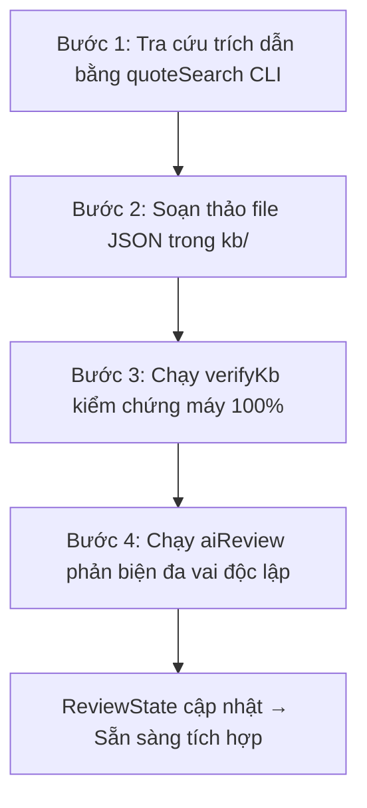

# Hướng Dẫn Soạn Thảo Knowledge Base (KB_AUTHORING.md)

Tài liệu hướng dẫn quy chuẩn dành cho các kỹ sư dữ liệu và chuyên gia lâm sàng khi biên soạn cơ sở tri thức (Knowledge Base) cho dự án GDMT-VN.

> **29/10/2026 — KB-HASH-01:** Review hiện hành phải dùng `hashVersion: "sha256-json-v2"` và SHA256 đầy đủ 64 ký tự. Hàm chung: `src/kb-types/contentHash.ts` (browser/CLI); `node.ts` và `index.ts` re-export cùng hàm. Bốn trường `review/contentHash/status/reports` chỉ được loại ở root; mọi khóa con đều thuộc nội dung được băm. Object được sắp khóa sâu; array giữ thứ tự; dùng ngữ nghĩa JSON, không nhận root undefined/function, BigInt hoặc cycle. Hash có tiền tố version trước nội dung.
>
> Khi đổi nội dung hoặc version, dùng `migrateReviewState()` để đưa báo cáo cũ vào `history`, reset `reports: []`, `status: "draft"`; không giữ trạng thái duyệt cũ khi chỉ thay hash. Preview toàn KB: `npx tsx tools/kb/migrateReviewHashes.ts`; áp dụng cần `--apply --backup reports/<thư-mục-mới>`. Công cụ kiểm tra toàn bộ input, giữ raw backup/manifest SHA256, không thực hiện review; chạy lại không tạo history trùng.
>
> 1.373 hồ sơ đã migrate; 1.621 báo cáo cũ được giữ nguyên. File `_sample` không phải dữ liệu hoạt động. `kb:review --dry-run` không lưu state hoặc cấp duyệt; CLI này hiện chỉ chạy mẫu, chưa là bộ điều phối review toàn KB. Các batch builder/patcher lịch sử chưa phát hành version mới phải được xem là công cụ cũ: không chạy đè hồ sơ review đang hoạt động; verifier từ chối tái dùng trạng thái không-draft thiếu version. Không dùng `tools/kb/aiClient.ts` để gọi provider cũ khi chưa được người dùng cho phép; task này chỉ dùng mocks/dry-run, không gọi provider.
>
> UI chỉ hiển thị trạng thái khi ID/version/hash khớp item hiện tại; `explicitStatus` từ rule không thể cấp duyệt. Thiếu/stale/legacy → draft, citation không cứu được một drug review stale. Hash cấp item không tự chứng minh provenance phụ thuộc, nguồn mới nhất, toàn bộ engine không đổi hoặc đủ hai vòng lâm sàng; vẫn cần snapshot đầy đủ và [REVIEW_PROTOCOL](REVIEW_PROTOCOL.md). Xem [báo cáo](../reports/kb-hash-01-20261029/README.md).

---

## 1. Nguyên Tắc Cốt Lõi

1. **Y học chứng cứ 100%**: Không có bất kỳ khuyến cáo, ngưỡng số, hoặc chỉ định thuốc nào được tạo ra mà không có trích dẫn nguồn gốc rõ ràng.
2. **Không số mồ côi (Zero Orphan Numbers)**: Mọi giá trị số (`value`) dùng trong luật lâm sàng, ngưỡng an toàn (`Threshold`), hoặc chỉnh liều thuốc (`DrugEntry`) **bắt buộc phải xuất hiện nguyên văn** trong trích dẫn liên kết (`Citation.quote`).
3. **Trích dẫn máy kiểm chứng (Machine-Verified Verbatim)**: Trích dẫn giữ nguyên văn ngôn ngữ gốc trong tài liệu PDF (tiếng Anh hoặc tiếng Việt) kèm số trang (`pdfPage`) để pipeline tự động so khớp từng ký tự.
4. **Duyệt đa tầng độc lập**: Mọi mục dữ liệu đều trải qua kiểm tra tự động (Schema, ID Integrity, Verbatim quote, Hash) và hội đồng phản biện AI (Guideline Checker, Clinical Pharmacist, Adversarial Reviewer, Specialist).

---

## 2. Cấu Trúc Thư Mục `kb/`

```
gdmt-vn/
  kb/
    sources.json           # Danh mục tài liệu nguồn (guideline, nhãn thuốc)
    citations/             # Trích dẫn nguyên văn theo từng module
      ckd.json
      dm2.json
      hf.json
      ...
    thresholds/            # Các ngưỡng số lâm sàng dùng trong luật
      ckd.json
      hf.json
      ...
    drugs/                 # Từ điển thuốc chi tiết (liều, chỉnh thận, cổng an toàn)
      sglt2i.json
      arni.json
      ...
    review/                # Trạng thái kiểm duyệt và content hash
      dapagliflozin.json
      ...
```

---

## 3. Quy Ước Đặt ID

Mọi định danh ID trong hệ thống phải tuân theo cấu trúc phân tầng phân tách bằng dấu chấm (`.`):

- **Source ID**: `<org>_<năm>_<chủ_đề>`
  - Ví dụ: `kdigo_2024_ckd`, `esc_2026_hf`, `ada_2026_soc_9`, `byt_2024_ckd`
- **Citation ID**: `<nguồn_hoặc_module>.<chủ_đề>.<nội_dung_ngắn>`
  - Ví dụ: `kdigo.ckd.2024.sglt2i_initiate`, `esc.hf.2026.dapagliflozin_dose_10mg`
- **Threshold ID**: `<module>.<nhóm_thuốc_hoặc_thông_số>.<tên_ngưỡng>`
  - Ví dụ: `ckd.sglt2i.egfr_initiate_min`, `hf.sglt2i.target_dose`, `htn.sbp_goal_general`
- **Drug ID**: Viết thường tên hoạt chất quốc tế (INN), không dấu, không khoảng trắng:
  - Ví dụ: `dapagliflozin`, `empagliflozin`, `sacubitril_valsartan`, `bisoprolol`

---

## 4. Chi Tiết Các Thực Thể

### 4.1 Nguồn Tài Liệu (`Source`)

Định nghĩa tài liệu chính thức trong kho `Medical_Library_2026` hoặc URL web snapshot:

```json
{
  "id": "kdigo_2024_ckd",
  "org": "KDIGO",
  "title": "KDIGO 2024 Clinical Practice Guideline for the Evaluation and Management of Chronic Kidney Disease",
  "year": 2024,
  "version": "2024",
  "localPath": "01_Noi_Khoa/Than/KDIGO_2024_CKD_Guideline.pdf",
  "url": "https://kdigo.org/guidelines/ckd-evaluation-and-management/",
  "jurisdiction": "INTL",
  "lang": "en"
}
```

- `jurisdiction`: `'INTL'` (Quốc tế), `'VN'` (Bộ Y tế Việt Nam), `'VN_SOCIETY'` (Hội chuyên khoa VN), `'US'` (Hoa Kỳ), `'LABEL'` (Nhãn thuốc FDA/EMA/Dược thư).

### 4.2 Trích Dẫn Nguyên Văn (`Citation`)

Mỗi `Citation` là một đoạn văn bản trích trực tiếp từ file PDF:

```json
{
  "id": "kdigo.ckd.2024.sglt2i_initiate",
  "sourceId": "kdigo_2024_ckd",
  "pdfPage": 44,
  "printedPage": "S215",
  "locator": "Recommendation 1.3.1 / PDF p. 44",
  "quote": "with CKD with an SGLT2i for the following (1A): /C15 eGFR ‡20 ml/min per 1.73 m 2 with urine ACR ‡200 mg/g ( ‡20 mg/mmol), or /C15 heart failure, irrespective of level of albumin",
  "quoteVi": "Khuyến cáo điều trị người bệnh CKD bằng SGLT2i trong các trường hợp sau (1A): eGFR >= 20 ml/min/1.73 m2 kèm ACR nước tiểu >= 200 mg/g, hoặc suy tim bất kể mức albumin niệu.",
  "cor": "1",
  "loe": "A"
}
```

> [!IMPORTANT]
> `quote` phải được lấy chính xác từng ký tự bằng công cụ `quoteSearch.ts`. Hệ thống cho phép dung sai `±1` trang (sẽ hiện cảnh báo `WARN_PAGE_TOLERANCE`), nhưng tốt nhất là ghi chính xác số trang PDF thực tế.

### 4.3 Ngưỡng Lâm Sàng (`Threshold`)

Mọi con số dùng trong điều kiện rẽ nhánh hoặc cổng an toàn phải được khai báo thành `Threshold`:

```json
{
  "id": "ckd.sglt2i.egfr_initiate_min",
  "value": 20,
  "unit": "mL/min/1.73m2",
  "quantity": "egfr",
  "citationIds": [
    "kdigo.ckd.2024.sglt2i_initiate"
  ],
  "descriptionVi": "Ngưỡng eGFR tối thiểu (20 mL/min/1.73m2) để bắt đầu khởi trị thuốc ức chế SGLT2 ở bệnh nhân CKD (KDIGO 2024 1A)"
}
```

> [!IMPORTANT]
> **Chính sách QA-10 (Đại lượng lâm sàng `quantity`):**
> Nhằm ngăn chặn triệt để lỗi "dùng nhầm ngưỡng trùng số" (ví dụ: lấy ngưỡng % giảm LDL `60%` đem so với mức lọc cầu thận `eGFR 60`, hoặc lấy điểm mMRC `2` đem so với số đợt cấp COPD), mỗi Threshold **bắt buộc phải khai báo trường `quantity`** khớp chính xác với đại lượng lâm sàng tương ứng:
> - Khớp trường của `need(ctx, ...)`: `'egfr'`, `'crcl'`, `'k'`, `'sbp'`, `'dbp'`, `'hr'`, `'lvef'`, `'uacr'`, `'hba1c'`, `'glucose'`, `'ldl'`, `'tg'`, `'urate'`, `'fev1_pct'`, `'fev1_fvc'`, `'eos'`, `'mmrc'`, `'cat'`, `'exacerbation_count'`, `'age'`, `'weight'`, `'bmi'`, `'dose_mg'`...
> - Các đại lượng phi-bệnh nhân / mục tiêu: `'ldl_reduction_pct'`, `'duration_days'`, `'interval_weeks'`, `'qrs_duration'`, `'percentage'`, `'ratio'`...
> - **Mỗi ý nghĩa lâm sàng = một Threshold riêng**, tuyệt đối không dùng chung Threshold kể cả khi có cùng giá trị số!

> [!WARNING]
> Quy tắc kiểm tra "Không số mồ côi": Con số `20` trong `value` **bắt buộc phải xuất hiện** trong nội dung `quote` của ít nhất một Citation được liệt kê trong `citationIds`. Nếu không, lệnh `verifyKb` sẽ báo lỗi và từ chối build.

### 4.4 Danh Mục Thuốc (`DrugEntry`)

Khai báo đầy đủ liều dùng, biệt dược tại Việt Nam, dải chỉnh liều theo chức năng thận và các cổng an toàn:

```json
{
  "id": "dapagliflozin",
  "nameVi": "Dapagliflozin",
  "inn": "Dapagliflozin",
  "class": "SGLT2i",
  "vnBrands": ["Forxiga"],
  "forms": ["Viên nén bao phim 10 mg", "Viên nén bao phim 5 mg"],
  "start": {
    "amount": 10,
    "unit": "mg",
    "frequency": "1 lần/ngày",
    "route": "uống"
  },
  "target": {
    "amount": 10,
    "unit": "mg",
    "frequency": "1 lần/ngày",
    "route": "uống"
  },
  "renal": [
    {
      "eGFRFrom": 20,
      "initiate": "rec",
      "continue": "rec",
      "dose": "10 mg 1 lần/ngày",
      "citationIds": ["kdigo.ckd.2024.sglt2i_initiate"]
    },
    {
      "eGFRTo": 20,
      "initiate": "not_rec",
      "continue": "ok",
      "dose": "10 mg 1 lần/ngày",
      "note": "Tiếp tục dùng cho đến khi bắt đầu lọc máu",
      "citationIds": ["kdigo.ckd.2024.sglt2i_continue_below_20"]
    }
  ],
  "gates": [
    {
      "id": "gate_dapa_egfr_min",
      "parameter": "eGFR",
      "operator": "<",
      "threshold": 20,
      "unit": "mL/min/1.73m2",
      "action": "hold",
      "messageVi": "Không bắt đầu khởi trị dapagliflozin nếu eGFR < 20 mL/min/1.73m2",
      "citationIds": ["kdigo.ckd.2024.sglt2i_initiate"]
    }
  ],
  "pregnancy": {
    "status": "contra",
    "notesVi": "Chống chỉ định trong tam cá nguyệt 2 và 3 do nguy cơ độc tính phát triển thận thai nhi (FDA & KDIGO 2024)",
    "citationIds": ["fda.dapagliflozin.ckd_dose"]
  },
  "lactation": {
    "status": "avoid",
    "notesVi": "Không khuyến cáo cho con bú do nguy cơ bài tiết qua sữa mẹ",
    "citationIds": ["fda.dapagliflozin.ckd_dose"]
  },
  "contraindications": [
    {
      "code": "pregnancy",
      "messageVi": "Chống chỉ định tuyệt đối Dapagliflozin trong thai kỳ",
      "citationIds": ["fda.dapagliflozin.ckd_dose"]
    },
    {
      "code": "dialysis",
      "messageVi": "Chống chỉ định khởi trị mới ở bệnh nhân lọc máu định kỳ",
      "citationIds": ["kdigo.ckd.2024.pp_3_7_1_continue_below_20"]
    }
  ],
  "interactions": [
    "Nguy cơ hạ huyết áp tư thế khi phối hợp với lợi tiểu quai liều cao"
  ],
  "citationIds": ["kdigo.ckd.2024.sglt2i_initiate", "esc.hf.2026.dapagliflozin_hf_rec"]
}
```

---

### 4.5 Chuẩn An Toàn Thai Kỳ & Chống Chỉ Định Máy Đọc (Phối hợp R3-CKD-01/02)

Để giải quyết triệt để nguy cơ kê đơn thuốc độc phôi thai (như SGLT2i, RASi, Statin, MRA) cho phụ nữ mang thai hoặc bỏ sót lệnh `STOP` khi bệnh nhân mang thai đang dùng sẵn thuốc, toàn bộ các tệp thuốc trong `kb/drugs/*.json` bắt buộc phải bổ sung các trường sau:

#### A. Thuộc tính `pregnancy` (BẮT BUỘC):
- `status`:
  - `'contra'`: Chống chỉ định tuyệt đối (Ví dụ: ACEi, ARB, ARNI, Statin, MRA, SGLT2i). Engine Safety Gates sẽ tự động chặn mọi lệnh `START`/`UPTITRATE` và tự động phát lệnh `STOP` khẩn cấp nếu bệnh nhân đang dùng sẵn trong `currentMeds`.
  - `'avoid'`: Tránh sử dụng, chỉ dùng khi không có giải pháp thay thế.
  - `'caution'`: Thận trọng, cần theo dõi sát chỉ số lâm sàng.
  - `'compatible'`: Tương thích, an toàn trong thai kỳ (Ví dụ: Methyldopa, Labetalol, Nifedipine, Insulin).
  - `'no_data'`: Chưa có đủ dữ liệu an toàn.
- `citationIds`: Bắt buộc gắn ít nhất 1 trích dẫn chứng cứ nhãn FDA / SmPC / Guideline.
- `notesVi` (tùy chọn): Giải thích cơ chế nguy cơ (ví dụ: quái thai, vô thận thai nhi, thiểu ối).

#### B. Thuộc tính `lactation` (Tùy chọn):
- `status`: `'contra'` | `'avoid'` | `'caution'` | `'compatible'` | `'no_data'`.
- `citationIds`: Trích dẫn thông tin an toàn khi cho con bú.

#### C. Mảng `contraindications` (Mã máy đọc):
Cho phép Engine tự động quét và đối chiếu trực tiếp với tiền căn hoặc điều kiện của bệnh nhân (`ctx.patient.conditions`):
- Các mã chuẩn được hỗ trợ:
  - `'pregnancy'`: Đang mang thai (`ctx.patient.conditions.pregnant = true`).
  - `'angioedema_history'`: Tiền sử phù mạch do thuốc hoặc vô căn.
  - `'mechanical_valve'`: Mang van tim cơ học (chống chỉ định DOAC).
  - `'severe_hypotension'`: Tụt huyết áp nặng / sốc tim.
  - `'dialysis'`: Bệnh nhân đang chạy thận nhân tạo định kỳ.
  - `'bilateral_renal_artery_stenosis'`: Hẹp động mạch thận hai bên.
  - `'hyperkalemia'`: Tăng kali máu nặng.
  - `'hla_b5801'`: Mang gen dị ứng HLA-B*58:01 (chống chỉ định Allopurinol).

---

### 4.6 Chuẩn Phân Rã Thuốc Phối Hợp & Nhóm Dược Lý Máy Đọc (`classes`, `components`, `qtRisk`)

Để phục vụ phát hiện trùng lặp nhóm thuốc đa bệnh (ví dụ: vô tình dùng 2 thuốc cùng nhóm MRA, hoặc bệnh nhân hô hấp vừa hít viên phối hợp ba thuốc vừa xịt thêm LABA đơn độc), hệ thống chuẩn hóa 3 thuộc tính mới:

#### A. Thuộc tính `classes: string[]` (BẮT BUỘC):
Mảng chứa các mã nhóm dược lý chuẩn hoá máy đọc.
- **Thuốc đơn chất**: `classes: ['sglt2i']`, `classes: ['statin']`, `classes: ['doac']`...
- **Thuốc phối hợp liều cố định (FDC)**: Chứa tất cả các nhóm thành phần, ví dụ thuốc ba trong một Trimbow/Trelegy:
  ```json
  "classes": ["ics", "lama", "laba"]
  ```
- **Danh mục mã chuẩn hoá**:
  - Tim mạch - Thận: `'acei'`, `'arb'`, `'arni'`, `'mra_steroidal'`, `'mra_nonsteroidal'`, `'sglt2i'`, `'bb_selective'`, `'bb_nonselective'`, `'ndhp_ccb'`, `'dhp_ccb'`, `'doac'`, `'vka'`, `'loop_diuretic'`, `'thiazide_diuretic'`, `'potassium_binder'`
  - Nội tiết - ĐTĐ: `'glp1ra'`, `'dpp4i'`, `'su'`, `'tzd'`, `'ag_inhibitor'`, `'insulin'`
  - Hô hấp: `'lama'`, `'laba'`, `'ics'`, `'saba'`, `'sama'`
  - Lipid: `'statin'`, `'cholesterol_absorption_inhibitor'`, `'pcsk9i'`, `'fibrate'`
  - Gút: `'urate_lowering'`, `'anti_gout'`

#### B. Thuộc tính `components?: string[]` (Dành cho thuốc phối hợp FDC):
Mảng chứa danh sách các `drugId` đơn chất cấu thành thuốc phối hợp:
```json
"components": [
  "fluticasone_furoate",
  "umeclidinium",
  "vilanterol"
]
```
Engine an toàn sẽ tự động phân rã thuốc phối hợp bệnh nhân đang uống/hít để phát hiện ngay các trường hợp trùng lặp thành phần hoạt chất tiềm ẩn.

#### C. Thuộc tính `qtRisk?: 'known' | 'possible' | 'conditional'` (Tùy chọn):
Đánh giá nguy cơ kéo dài khoảng QT và loạn nhịp xoắn đỉnh (TdP) theo chuẩn CredibleMeds hoặc nhãn thuốc:
- `'known'`: Nguy cơ đã được xác lập rõ (Ví dụ: Amiodarone, Sotalol, Azithromycin, Moxifloxacin).
- `'possible'`: Nguy cơ có thể xảy ra trong một số điều kiện lâm sàng.
- `'conditional'`: Nguy cơ phụ thuộc liều cao, hạ kali máu, hạ magnesi máu hoặc dùng kèm thuốc ức chế chuyển hóa.

---

## 5. Quy Trình 4 Bước Soạn Thảo & Thẩm Định



### Bước 1: Tra cứu câu trích dẫn nguyên văn
Sử dụng công cụ `quoteSearch.ts` để tra từ khóa trong guideline mục tiêu:
```bash
# Xem danh sách các PDF hiện có
npx tsx tools/kb/quoteSearch.ts --list

# Tìm kiếm từ khóa trong tài liệu cụ thể
npx tsx tools/kb/quoteSearch.ts --pdf "01_Noi_Khoa/Than/KDIGO_2024_CKD_Guideline.pdf" --query "20 ml/min" --max 5

# Tìm kiếm trên toàn bộ thư viện
npx tsx tools/kb/quoteSearch.ts --all --query "eGFR < 20" --max 10
```
Sao chép chính xác đoạn `snippet` và số trang `pdfPage` trả về.

### Bước 2: Soạn thảo dữ liệu JSON
Điền vào các file tương ứng trong `kb/citations/`, `kb/thresholds/`, `kb/drugs/`.

### Bước 3: Kiểm chứng tự động (Máy kiểm tra)
Chạy script kiểm tra:
```bash
npx tsx tools/kb/verifyKb.ts
```
Pipeline sẽ tự động quét và kiểm tra 5 tiêu chí:
1. Schema JSON hợp lệ.
2. Tham chiếu ID toàn vẹn (không có ID nào trỏ đến đối tượng không tồn tại).
3. So khớp nguyên văn từng ký tự trong PDF nguồn (kiểm tra hash cache hoặc trích xuất pypdf).
4. Kiểm tra không có số mồ côi: Mọi Threshold đều có mặt trong văn bản trích dẫn.
5. Kiểm tra tính ổn định của Content Hash.

Nếu phát hiện bất kỳ lỗi nào, script sẽ thoát với exit code 1 và tạo báo cáo chi tiết trong `reports/kb/verify_<timestamp>.json`.

### Bước 4: Chạy phản biện AI đa vai (`aiReview`)
Chạy hội đồng chuyên gia AI duyệt nội dung lâm sàng:
```bash
# Chạy mô phỏng không tốn token (cho CI/CD hoặc kiểm tra cấu trúc):
npx tsx tools/kb/aiReview.ts --dry-run

# Chạy review thật bằng DeepSeek V4.1:
npx tsx tools/kb/aiReview.ts --item dapagliflozin
```
Khi 3 vai cốt lõi đều đánh giá `pass`, trạng thái mục sẽ được nâng lên `ai_cross_checked`. Khi có thêm vòng chuyên khoa (Nephrologist, Cardiologist...) và không có vấn đề tồn đọng, trạng thái sẽ là `ai_multi_reviewed`.

---

## 6. Xử Lý Khi Có Sửa Đổi Dữ Liệu

Khi bạn sửa bất kỳ thuộc tính lâm sàng nào của một Thuốc hay Ngưỡng đã được duyệt:
1. `computeContentHash` sẽ thay đổi.
2. `verifyKb` sẽ phát hiện sự không đồng bộ giữa `contentHash` mới và hash trong `ReviewState`, đồng thời báo lỗi `STALE_REVIEW_HASH`.
3. Bạn bắt buộc phải chạy lại `aiReview` để hội đồng kiểm duyệt lại nội dung mới trước khi có thể build thành công.
