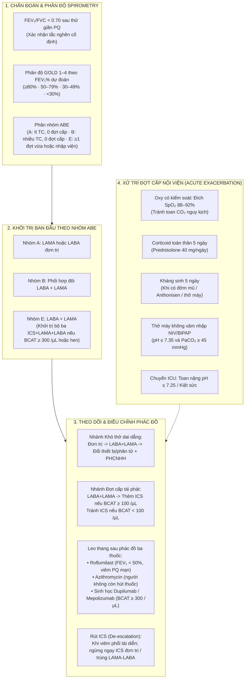

# GDMT-VN – Đặc Tả Module Bệnh Phổi Tắc Nghẽn Mạn Tính (COPD.md)

**Mã định danh:** `copd`  
**Tên module:** Bệnh phổi tắc nghẽn mạn tính (Chronic Obstructive Pulmonary Disease)  
**Kỹ sư chuyên trách:** Agent L (Chuyên gia Hô hấp kiêm Kỹ sư GDMT-VN)  
**Nguồn tài liệu nền tảng:**
- **INTL (Quốc tế):**
  - *GOLD 2026 Global Strategy for Prevention, Diagnosis and Management of COPD (2026 Report v1.2)*
  - *GOLD 2026 Pocket Guide to COPD Diagnosis, Management, and Prevention*
  - *GOLD 2026 Key Changes Summary*
- **VN (Bộ Y tế Việt Nam):**
  - *Bộ Y tế Quyết định số 2131/QĐ-BYT ngày 14/07/2026 Hướng dẫn chẩn đoán và điều trị bệnh phổi tắc nghẽn mạn tính*
  - *Bộ Y tế Quyết định số 2767/QĐ-BYT năm 2023 Hướng dẫn chẩn đoán và điều trị bệnh phổi tắc nghẽn mạn tính*
- **Nhãn thuốc chính thức:**
  - FDA DailyMed Prescribing Information: *DALIRESP (roflumilast) tablets*
  - FDA DailyMed Prescribing Information: *DUPIXENT (dupilumab) injection*

---

## 1. Cấu Trúc Tổng Thể & Kiến Trúc Lâm Sàng

Module COPD được xây dựng theo định dạng y học chứng cứ phân tầng, kết hợp mô hình tiếp cận đa chiều của GOLD 2026 và QĐ 2131/QĐ-BYT 2026:

---

## 2. Danh Mục 23 Thuốc Sở Hữu (`kb/drugs/`)

Module COPD sở hữu và quản lý đầy đủ **23 thuốc/phối hợp thuốc** chuyên khoa hô hấp và dự phòng huyết khối nội viện (theo `DRUG_OWNER_MAP['Agent L (COPD)']`):

| STT | Hoạt chất / Phối hợp | ID hệ thống | Phân nhóm dược lý | Tên biệt dược tại VN | Dạng dùng & Hàm lượng | Liều dùng chuẩn |
|:---:|---|---|---|---|---|---|
| 1 | **Tiotropium** | `tiotropium` | LAMA | Spiriva Respimat, Spiriva HandiHaler | Dung dịch hạt mịn 2.5 mcg/nhát, nang bột hít 18 mcg | 2 nhát Respimat x 1 lần/ngày (5 mcg) hoặc 1 viên HandiHaler/ngày |
| 2 | **Umeclidinium** | `umeclidinium` | LAMA | Chưa lưu hành đơn chất tại VN (có trong Anoro/Trelegy Ellipta) | Bột hít phân liều 55 mcg/liều (giao tới phổi) | 1 liều Ellipta x 1 lần/ngày vào buổi sáng |
| 3 | **Glycopyrronium** | `glycopyrronium` | LAMA | Seebri Breezhaler | Viên nang chứa bột hít 50 mcg | 1 viên nang Breezhaler x 1 lần/ngày |
| 4 | **Aclidinium** | `aclidinium` | LAMA | Chưa lưu hành đơn chất tại VN (quốc tế: Eklira Genuair) | Bột hít phân liều Genuair 322 mcg/liều | 1 liều Genuair x 2 lần/ngày (sáng và tối) |
| 5 | **Indacaterol** | `indacaterol` | LABA | Onbrez Breezhaler | Viên nang chứa bột hít 150 mcg, 300 mcg | 1 viên nang Breezhaler 150 mcg x 1 lần/ngày (tối đa 300 mcg) |
| 6 | **Olodaterol** | `olodaterol` | LABA | Chưa lưu hành đơn chất tại VN (có trong Spiolto Respimat) | Dung dịch phun hạt mịn 2.5 mcg/nhát | 2 nhát Respimat x 1 lần/ngày (5 mcg) |
| 7 | **Salmeterol** | `salmeterol` | LABA | Serevent Accuhaler / Evohaler | Bột hít 50 mcg/liều, pMDI 25 mcg/nhát | 50 mcg x 2 lần/ngày (chống chỉ định dùng kèm chất ức chế mạnh CYP3A4) |
| 8 | **Vilanterol** | `vilanterol` | LABA | Chưa lưu hành đơn chất tại VN (có trong Anoro/Relvar/Trelegy Ellipta) | Bột hít phân liều cố định 25 mcg (22 mcg) | 1 liều x 1 lần/ngày (chỉ lưu hành trong dạng phối hợp đôi/ba) |
| 9 | **Formoterol** | `formoterol` | LABA | Oxis Turbuhaler, Foradil | Bột hít / nang hít 4.5–12 mcg | 4.5–12 mcg x 2 lần/ngày (không dùng đơn trị nếu kèm hen) |
| 10 | **Tiotropium/Olodaterol** | `tiotropium_olodaterol` | LAMA + LABA | Spiolto Respimat | Hạt mịn: Tiotropium 2.5 mcg / Olodaterol 2.5 mcg | 2 nhát Respimat x 1 lần/ngày vào buổi sáng |
| 11 | **Umeclidinium/Vilanterol** | `umeclidinium_vilanterol` | LAMA + LABA | Anoro Ellipta | Bột hít: Umeclidinium 62.5 mcg / Vilanterol 25 mcg | 1 liều Ellipta x 1 lần/ngày |
| 12 | **Indacaterol/Glycopyrronium** | `glycopyrronium_indacaterol` | LAMA + LABA | Ultibro Breezhaler | Bột hít: Indacaterol 110 mcg / Glycopyrronium 50 mcg | 1 viên nang Breezhaler x 1 lần/ngày |
| 13 | **Fluticasone furoate/Umeclidinium/Vilanterol** | `fluticasone_furoate_umeclidinium_vilanterol` | ICS + LAMA + LABA | Trelegy Ellipta | Bột hít 100 mcg / 62.5 mcg / 25 mcg | 1 liều Ellipta x 1 lần/ngày (súc họng sau hít) |
| 14 | **Budesonide/Glycopyrronium/Formoterol** | `budesonide_glycopyrronium_formoterol` | ICS + LAMA + LABA | Breztri Aerosphere | pMDI Aerosphere 160 mcg / 7.2 mcg / 4.8 mcg | 2 nhát x 2 lần/ngày (sáng và tối) |
| 15 | **Beclometasone/Glycopyrronium/Formoterol** | `beclometasone_glycopyrronium_formoterol` | ICS + LAMA + LABA | Chưa lưu hành tại VN (quốc tế: Trimbow) | pMDI hạt siêu mịn 87 mcg / 9 mcg / 5 mcg | 2 nhát x 2 lần/ngày |
| 16 | **Ipratropium/Salbutamol** | `ipratropium_salbutamol` | SAMA + SABA | Combivent | Ống khí dung 0.5 mg / 2.5 mg | Khí dung đợt cấp mỗi 4–6 giờ (chống chỉ định glôcôm góc đóng / bí tiểu) |
| 17 | **Ipratropium/Fenoterol** | `ipratropium_fenoterol` | SAMA + SABA | Berodual | pMDI 20/50 mcg; dung dịch khí dung 0.25/0.5 mg/mL | Xịt cắt cơn 1–2 nhát hoặc khí dung đợt cấp (tránh dùng định kỳ chồng LAMA) |
| 18 | **Roflumilast** | `roflumilast` | PDE4 inhibitor | Chưa lưu hành rộng rãi tại VN (quốc tế: Daxas, Daliresp) | Viên nén 250 mcg, 500 mcg | Khởi đầu 250 mcg x 1 lần/ngày x 4 tuần; duy trì 500 mcg/ngày |
| 19 | **Azithromycin** (dự phòng) | `azithromycin` | Macrolide | Zithromax, Azithromycin | Viên nén/nang 250 mg, 500 mg | 250 mg/ngày hoặc 500 mg x 3 lần/tuần x 1 năm (người không hút thuốc) |
| 20 | **Dupilumab** | `dupilumab` | Anti-IL-4Rα mAb | Dupixent | Bút tiêm nạp sẵn 300 mg/2 mL | 300 mg tiêm dưới da mỗi 2 tuần (BCAT ≥ 300 + Viêm PQ mạn) |
| 21 | **Mepolizumab** | `mepolizumab` | Anti-IL-5 mAb | Nucala | Bút tiêm tự động 100 mg/mL | 100 mg tiêm dưới da mỗi 4 tuần (BCAT ≥ 300 /µL) |
| 22 | **Theophylline** | `theophylline` | Methylxanthine | Theostat, Asmacon | Viên phóng thích kéo dài 100, 200, 300 mg | 100–200 mg x 2 lần/ngày (< 10 mg/kg/ngày; tránh dùng trong đợt cấp) |
| 23 | **Enoxaparin & Heparin** | `enoxaparin`, `heparin` | LMWH / UFH | Lovenox, Heparin | Bơm tiêm dưới da 40 mg/0.4 mL; lọ tiêm UFH 5.000 IU | Dự phòng VTE đợt cấp nội viện (Enoxaparin 40 mg TDD/ngày; UFH 5.000 IU q8–12h khi eGFR < 30; tránh khi HIT / tiểu cầu < 50 G/L) |

*(Ghi chú: Thuốc cắt cơn ngắn SABA Salbutamol, SAMA Ipratropium, Corticoid toàn thân Prednisolone/Methylprednisolone và phối hợp ICS-LABA do Agent M - Hen sở hữu; module `copd` tham chiếu chính xác qua ID).*

---

## 3. Đặc Tả Đầu Vào Lâm Sàng Động (`inputs.ts`)

Giao diện `PatientForm` tự động nạp các trường dữ liệu khi người dùng chọn thẻ bệnh **COPD**:

1. **Phế dung kế (Spirometry):**
   - `customInputs.fev1FvcRatio`: Tỷ lệ FEV₁/FVC sau giãn phế quản (bắt buộc để xác nhận tắc nghẽn).
   - `customInputs.fev1PredPct`: FEV₁ % dự đoán (bắt buộc để phân độ GOLD 1–4).
2. **Triệu chứng & Tiền sử đợt cấp (Phân nhóm ABE):**
   - `customInputs.mmrc`: Thang điểm khó thở mMRC (0 đến 4).
   - `customInputs.cat`: Điểm đánh giá COPD (0 đến 40).
   - `customInputs.moderateExacerbations`: Số đợt cấp mức độ vừa (dùng steroid/kháng sinh ngoại trú).
   - `customInputs.hospitalizations`: Số đợt cấp nặng phải nhập viện/cấp cứu trong 12 tháng qua.
3. **Chỉ dấu sinh học, Kiểu hình & Cổng an toàn thuốc:**
   - `customInputs.bloodEos`: Số lượng bạch cầu ái toan máu (/µL).
   - `customInputs.currentInhaler`: Phác đồ thuốc hít duy trì hiện tại (`none`, `saba_sama`, `lama_mono`, `laba_mono`, `laba_lama`, `ics_laba`, `triple`).
   - `customInputs.chronicBronchitis`: Kiểu hình viêm phế quản mạn (ho khạc đờm ≥ 3 tháng/năm trong 2 năm).
   - `conditions.priorAsthma`: Tiền sử hen phế quản đồng mắc.
   - `customInputs.priorPneumonia`: Tiền sử viêm phổi tái diễn khi dùng ICS.
   - `customInputs.weakInspiratoryFlow`: Lưu lượng đỉnh hít vào yếu (< 60 L/phút) / phối hợp thao tác kém (chuyển DPI sang SMI/pMDI + buồng đệm).
   - `customInputs.severeMilkProteinAllergy`: Dị ứng nặng / phản vệ với đạm sữa bò (chống chỉ định tuyệt đối DPI chứa tá dược lactose).
   - `conditions.depression`: Trầm cảm nặng hoặc tiền sử ý nghĩ / hành vi tự sát (tránh dùng Roflumilast).
   - `customInputs.childPugh`: Phân loại suy gan Child-Pugh (`none`, `A`, `B`, `C`; chống chỉ định Roflumilast ở Child-Pugh B/C).
   - `customInputs.unexplainedWeightLoss`: Sụt cân chưa rõ nguyên nhân / suy kiệt (kết hợp tự động tính BMI < 18.5 kg/m² để chặn Roflumilast).
   - `customInputs.qtcProlonged`, `customInputs.hearingImpairment`, `customInputs.ntmInfection`: Cổng an toàn chống chỉ định Azithromycin dài hạn.
4. **Hút thuốc, Oxy dài hạn & Tiêm chủng:**
   - `customInputs.smokingStatus`: Tình trạng hút thuốc (`current`, `former`, `never`).
   - `customInputs.packYears`: Số gói-năm.
   - `customInputs.restingSpo2`: SpO₂ khi nghỉ (%).
   - `customInputs.pao2`: PaO₂ khi nghỉ (mmHg).
   - `customInputs.corPulmonaleOrPolycythemia`: Tâm phế mạn / Phù suy tim phải / Đa hồng cầu.
5. **Đợt cấp nội viện & Khí máu động mạch:**
   - `customInputs.acuteExacerbation`: Cờ đợt cấp cấp cứu/nội viện.
   - `customInputs.onSupplementalOxygen`: Đang thở oxy bổ sung (phân biệt tự thở khí phòng vs đang thở oxy khi điều chỉnh đích SpO₂ 88–92%).
   - `customInputs.abgPh`: pH máu động mạch.
   - `customInputs.abgPaco2`: PaCO₂ máu động mạch (mmHg).
   - `customInputs.purulentSputum`: Đờm mủ (tiêu chuẩn Anthonisen).
   - `customInputs.increasedSputumVolume`: Tăng lượng đờm.
   - `customInputs.accessoryMuscleUse`: Co kéo cơ hô hấp phụ / hô hấp nghịch thường.
   - `customInputs.alteredMentalStatus`: Rối loạn tri giác (lú lẫn, ngủ gà, lơ mơ – chống chỉ định NIV, ưu tiên đặt NKQ).

---

## 4. Cây Quyết Định Lâm Sàng Chi Tiết

### 4.1. Khởi Trị Ban Đầu (Initial Treatment) & An Toàn Đơn Thuốc Nền
- **Rà soát an toàn tự động trên `currentMeds`:**
  - Tự động phát lệnh `STOP` nếu phát hiện **ICS đơn trị** ở bệnh nhân COPD không kèm hen (`rec_copd_stop_ics_monotherapy`), **trùng lặp ≥ 2 thuốc chứa LAMA** (`rec_copd_stop_duplicate_lama`), **trùng lặp ≥ 2 thuốc chứa LABA** (`rec_copd_stop_duplicate_laba`), hoặc dừng bình hít cũ khi nâng bậc/chuyển đổi (`rec_copd_stop_superseded_inhaler`).
  - Khi đồng mắc hen phế quản (`priorAsthma` / `asthma` hoặc chọn đồng thời module `asthma`): Bắt buộc phác đồ nền có chứa ICS; nếu module `asthma` đã kê ICS+LABA (`budesonide_formoterol`), module `copd` chỉ phối hợp thêm `tiotropium` (LAMA) để tạo thành bộ ba mà không trùng LABA/ICS.
- **Nhóm A (Ít triệu chứng mMRC < 2 và CAT < 10, 0 đợt cấp vừa/nặng trong 12 tháng):**
  - Khởi đầu: 1 thuốc giãn phế quản tác dụng kéo dài (`tiotropium` 5 mcg/ngày hoặc `indacaterol` 150 mcg/ngày).
- **Nhóm B (Nhiều triệu chứng mMRC ≥ 2 hoặc CAT ≥ 10, 0 đợt cấp vừa/nặng trong 12 tháng):**
  - Khởi đầu: Phối hợp đôi LABA + LAMA (`tiotropium_olodaterol` 2 nhát Respimat sáng hoặc `umeclidinium_vilanterol` 1 hít sáng).
- **Nhóm E (Nguy cơ đợt cấp cao: ≥ 1 đợt cấp mức độ vừa hoặc ≥ 1 đợt nhập viện trong 12 tháng qua theo GOLD 2026 & BYT QĐ 2131/2026):**
  - Nếu **BCAT máu ≥ 300 /µL**: Cân nhắc khởi đầu ngay phác đồ ba thuốc Single-inhaler Triple therapy (`fluticasone_furoate_umeclidinium_vilanterol` Trelegy Ellipta 1 lần/ngày hoặc `budesonide_glycopyrronium_formoterol` Breztri 2 nhát x 2 lần/ngày).
  - Nếu **BCAT máu < 300 /µL** (và không có hen): Khởi đầu với phối hợp đôi LABA + LAMA (`tiotropium_olodaterol`).

### 4.2. Nhánh Theo Dõi (Follow-up Treatment)
- **Nhánh Khó thở dai dẳng (Dyspnea Pathway):**
  - Đang dùng mono LAMA/LABA -> Nâng bậc `SWITCH` lên LABA + LAMA và `STOP` bình đơn chất cũ.
  - Đang dùng LABA + LAMA mà vẫn khó thở: Không thêm ICS chỉ vì khó thở; kiểm tra kỹ thuật hít, cân nhắc chuyển đổi thiết bị (SMI Respimat / pMDI + buồng đệm nếu lưu lượng hít yếu) hoặc đổi phân tử hoạt chất, kết hợp phục hồi chức năng hô hấp.
- **Nhánh Xuất hiện đợt cấp (Exacerbation Pathway):**
  - Đang dùng mono LAMA/LABA mà xuất hiện đợt cấp: Nâng lên Triple (nếu BCAT ≥ 300 /µL) hoặc LABA + LAMA (nếu BCAT < 300 /µL).
  - Đang dùng LABA + LAMA mà xuất hiện đợt cấp:
    - Nếu **BCAT ≥ 100 /µL**: Nâng bậc bổ sung ICS thành phác đồ ba thuốc (Triple therapy) và dừng bình đôi cũ.
    - Nếu **BCAT < 100 /µL**: **CẤM/TRÁNH THÊM ICS** vì không hiệu quả và làm tăng đáng kể nguy cơ viêm phổi nặng.
  - Đang dùng LABA + LAMA (khi BCAT < 100) hoặc Triple therapy mà vẫn tái phát đợt cấp:
    - **Roflumilast (`CONSIDER`, khởi đầu 250 mcg/ngày x 4 tuần rồi 500 mcg/ngày):** Cân nhắc khi FEV₁ < 50% dự đoán và có kiểu hình viêm phế quản mạn. **Chống chỉ định / tránh dùng** khi suy gan vừa–nặng (Child-Pugh B/C, bệnh gan/xơ gan), nhẹ cân hoặc sụt cân chưa rõ nguyên nhân, tiền sử trầm cảm nặng / ý định tự sát, hoặc mang thai.
    - **Azithromycin (`CONSIDER`, 250 mg/ngày hoặc 500 mg x 3 lần/tuần):** Cân nhắc ở bệnh nhân không còn hút thuốc lá (`former` hoặc `never` smoker). **Chống chỉ định / tránh dùng** khi QTc kéo dài, đang dùng thuốc kéo dài khoảng QT (`amiodarone`, `sotalol`, fluoroquinolone...), giảm thính lực/ù tai hoặc nghi ngờ nhiễm NTM.
    - **Thuốc sinh học (GOLD 2026 & BYT QĐ 2131/2026):**
      - **Dupilumab (`CONSIDER`, 300 mg TDD mỗi 2 tuần):** COPD có đợt cấp tái phát trên triple therapy, BCAT ≥ 300 /µL và có kiểu hình viêm phế quản mạn.
      - **Mepolizumab (`CONSIDER`, 100 mg TDD mỗi 4 tuần):** COPD có đợt cấp tái phát trên triple therapy, BCAT ≥ 300 /µL (có hoặc không kèm viêm phế quản mạn; hiển thị trên cả INTL và VN kèm ghi chú tình trạng đăng ký chỉ định COPD tại VN).
- **Rút ICS (De-escalation):**
  - Xem xét rút thành phần ICS (chuyển về LABA + LAMA) khi bệnh nhân gặp tác dụng phụ nặng (viêm phổi tái diễn).
  - *Cảnh báo an toàn:* Nếu BCAT ≥ 300 /µL, việc rút ICS làm tăng rõ rệt nguy cơ đợt cấp bùng phát lại, cần theo dõi sát.

---

## 5. Xử Trí Đợt Cấp Nội Viện (Acute Exacerbation)

1. **Oxy có kiểm soát:**
   - Đích bão hòa oxy SpO₂: **88–92%** (PaO₂ 60–70 mmHg) qua gọng mũi hoặc mặt nạ Venturi.
   - Thử lại khí máu động mạch sau 30–60 phút thở oxy.
   - *Cảnh báo:* Tránh thở oxy liều cao vượt mức làm mất phản xạ kích thích hô hấp do thiếu oxy, dẫn tới ứ trệ CO₂ nguy kịch và hôn mê toan hô hấp.
2. **Corticoid toàn thân:**
   - Liều chuẩn: Prednisone/Prednisolone **40 mg uống/ngày trong đúng 5 ngày** (hoặc Methylprednisolone 40 mg tiêm TM/ngày).
   - Liệu trình 5 ngày hiệu quả ngang 14 ngày mà giảm thiểu tác dụng phụ toàn thân.
3. **Kháng sinh đợt cấp (5 ngày):**
   - Chỉ định khi có đủ 3 triệu chứng Anthonisen (tăng khó thở, tăng thể tích đờm, đờm mủ), hoặc 2 triệu chứng trong đó có đờm mủ, hoặc bệnh nhân phải thở máy (xâm nhập hoặc không xâm nhập).
4. **Thông khí nhân tạo không xâm nhập (NIV / BiPAP):**
   - Chỉ định đầu tay: Toan hô hấp cấp (**pH ≤ 7.35 và PaCO₂ ≥ 45 mmHg**), kèm khó thở nặng co kéo cơ hô hấp phụ.
   - Giúp giảm tỷ lệ đặt nội khí quản và giảm tỷ lệ tử vong bệnh viện.
5. **Tiêu chuẩn chuyển Khoa Hồi sức tích cực (ICU):**
   - Toan hô hấp nặng nguy kịch (**pH ≤ 7.25** hoặc PaCO₂ > 60 mmHg).
   - Rối loạn tri giác (lú lẫn, lơ mơ, hôn mê) hoặc kiệt sức cơ hô hấp.
   - Giảm oxy máu nặng dai dẳng (PaO₂ < 40 mmHg) dù đã thở oxy tối ưu.
   - Huyết động không ổn định (tụt HA, sốc).
6. **Dự phòng huyết khối thuyên tắc tĩnh mạch (VTE):**
   - LMWH (Enoxaparin 40 mg/ngày) cho bệnh nhân đợt cấp nằm bất động tại giường.
7. **Checklist trước khi xuất viện:**
   - Đánh giá lâm sàng ổn định ≥ 24 giờ.
   - Kiểm tra kỹ thuật sử dụng dụng cụ hít.
   - Kê đơn duy trì tối ưu (LABA+LAMA hoặc Triple).
   - Hẹn tái khám trong vòng 1–4 tuần.

---

## 6. So Sánh Đối Chiếu Guideline: GOLD 2026 vs Bộ Y Tế QĐ 2131/2026 (`profileDiff`)

| Tiêu chí | GOLD 2026 (Quốc tế - INTL) | Bộ Y tế QĐ 2131/2026 (Việt Nam - VN) | Xử trí của Engine GDMT-VN |
|---|---|---|---|
| **Phân nhóm ABE** | Gộp nhóm C và D thành nhóm E (Exacerbation). Nhóm E gồm ≥ 1 đợt nhập viện hoặc ≥ 1 đợt vừa trong năm trước. | Đã cập nhật phân nhóm ABE tương đồng GOLD 2026. | Thống nhất phân nhóm ABE chuẩn xác trên cả 2 profile. |
| **Khởi trị Nhóm B** | Bắt buộc khởi đầu ngay bằng phối hợp đôi LABA + LAMA. | Ưu tiên phối hợp đôi LABA + LAMA; tuy nhiên tại tuyến y tế cơ sở chưa có thuốc phối hợp, cho phép đơn trị LAMA hoặc LABA. | Sinh khuyến cáo `START` LABA + LAMA kèm cờ `profileDiff` hướng dẫn linh hoạt cho tuyến cơ sở. |
| **Roflumilast** | Khuyến cáo cân nhắc cho bệnh nhân FEV₁ < 50%, viêm phế quản mạn và tiền sử đợt cấp nặng (chống chỉ định suy gan Child-Pugh B/C, tránh ở người suy kiệt/trầm cảm). | Đưa Roflumilast vào lưu đồ theo dõi (BYT 2131/2026), lưu ý nguồn cung ứng hạn chế tại các bệnh viện VN. | Sinh khuyến cáo `CONSIDER` khi đủ tiêu chuẩn và không có chống chỉ định (`AVOID`/`STOP` nếu có bệnh gan/trầm cảm/sụt cân), kèm `profileDiff` cho VN. |
| **Thuốc sinh học** | Khuyến cáo chính thức Dupilumab (BOREAS/NOTUS, kèm viêm PQ mạn) và Mepolizumab (MATINEE, có hoặc không viêm PQ mạn) khi BCAT ≥ 300 /µL. | BYT QĐ 2131/2026 cập nhật cả Dupilumab và Mepolizumab tại trang 25; lưu ý Mepolizumab chưa có SĐK chỉ định COPD tại VN và chi phí BHYT hạn chế. | Cả hai profile `INTL` và `VN` đều sinh `CONSIDER` Dupilumab/Mepolizumab kèm `profileDiff` nêu rõ tình trạng đăng ký & chi trả BHYT tại VN. |
| **Corticoid đợt cấp** | Khuyến cáo duy nhất 40 mg prednisone/prednisolone trong đúng 5 ngày. | Prednisolone 40 mg uống 5–7 ngày hoặc Methylprednisolone 40–80 mg tiêm TM/ngày tùy mức độ nặng. | Mặc định 5 ngày theo chứng cứ RCT mới nhất; profile VN hiển thị khung 5–7 ngày. |

---

## 7. Bảng Đặc Điểm Thiết Bị Hít Có Tại Việt Nam

| Thiết bị | Cơ chế phân phối | Lực hít yêu cầu | Phối hợp tay - miệng | Bệnh nhân phù hợp tại VN |
|---|---|---|---|---|
| **SMI Respimat** (Spiolto, Spiriva, Striverdi) | Phun sương hạt mịn vận tốc chậm (1.5 giây) | Rất thấp, không phụ thuộc lực hít | Trung bình | Người cao tuổi, người có lưu lượng hít thở yếu (PIF < 30 L/phút), suy kiệt |
| **DPI Breezhaler** (Onbrez, Ultibro, Seebri) | Bột khô từ viên nang, sức cản nội tại thấp | Cao (cần hít nhanh và sâu > 60 L/phút) | Rất dễ (không cần bấm hít đồng thì) | Người trẻ - trung niên, lực hít tốt, thích nghe tiếng viên nang quay |
| **DPI Ellipta** (Anoro, Trelegy, Incruse) | Bột khô định liều sẵn trong vỉ dải dính | Trung bình (> 30–50 L/phút) | Rất dễ (mở nắp là sẵn sàng, đếm liều rõ) | Bệnh nhân cần tiện lợi, 1 lần/ngày, tuân thủ phác đồ tốt |
| **pMDI** (Breztri, Trimbow, Serevent) | Khí dung định liều nén áp lực | Thấp | Khó (dễ bấm hít lệch thì nếu không có buồng đệm) | Nên dùng kèm buồng đệm có van (Spacer) cho người già |
| **Máy khí dung (Nebulizer)** | Dung dịch khí dung qua máy nén khí/siêu âm | Thở bình thường | Không đòi hỏi phối hợp | Đợt cấp nặng, bệnh nhân cấp cứu, suy hô hấp không thể tự hít dụng cụ |

---

## 8. Kết Quả Kiểm Thẩm Định & Đảm Bảo Chất Lượng Vòng 4 (Round 4 QA & Adversarial Safety Verification)

- **Kiến trúc phân rã mô-đun `< 20 KB` (`src/modules/copd/` — 41 tệp `.ts`, lớn nhất `20.444 B < 20.480 B`):**
  - Nhóm hàm phụ trợ & hằng số: `helpers.constants.ts`, `helpers.drug_sets.ts`, `helpers.clinical.ts`, `helpers.inhalers.ts`, `helpers.inhalers_plan.ts`, `helpers.aco.ts`, `helpers.oral_safety.ts`, `helpers.ts`.
  - Nhóm chẩn đoán, khởi trị, theo dõi & leo thang: `rules.diagnosis.ts`, `rules.initial.ts`, `rules.followup.continue.ts`, `rules.followup.stepup_bronch.ts`, `rules.followup.stepup_ics.ts`, `rules.followup.aco.ts`, `rules.escalation.oral.ts`, `rules.escalation.biologics.ts`, `rules.nonpharm.ts`, `rules.nonpharm.prevention.ts`.
  - Nhóm an toàn dược lâm sàng & đợt cấp nội/ngoại trú: `rules.safety.inhalers_stop.ts`, `rules.safety.inhalers_device.ts`, `rules.safety.cardio.ts`, `rules.safety.systemic.ts`, `rules.inpatient.bronch_o2.ts`, `rules.inpatient.meds.ts`, `rules.inpatient.abx.ts`, `rules.inpatient.vent_icu.ts`, `rules.inpatient.vte_discharge.ts`.
  - Nhóm giao diện, ma trận & ca mẫu: `inputs.stable.ts`, `inputs.acute.ts`, `matrices.therapy.ts`, `matrices.devices.ts`, `pathways.ts`, `presets.ts` (hỗ trợ đầy đủ cả 3 hồ sơ `INTL`, `VN`, `US`).
- **Kiểm tra Knowledge Base & Linter (`npm run verify:kb` & `rulesLint.ts`):**
  - `CLINICAL_DEFAULT_NUMBER` (`?? <số>`): **0 lỗi**
  - `QA10_QUANTITY_MISMATCH` & `MISSING_QUANTITY`: **0 lỗi / 0 cảnh báo** trên toàn bộ **92 Thresholds** của COPD (`thFor(quantity, id)` 100%, 92 tệp review `auto_checked`)
  - **150 Citations** trong `kb/citations/copd.json`: 100% nguyên văn từ PDF nguồn (`GOLD 2026`, `GINA 2026`, `BYT QĐ 2131/2026`, `BYT QĐ 2767/2023`, `BYT VTE 2023`, `FDA DailyMed` & `EMA SmPC`), 0 watermark, 0 trường `cor` giả lập ngoài nguồn ESC.
  - **23/23 thuốc sở hữu**: Phủ kín 100% dải thận từ `eGFRFrom: 0` đến `∞` (0 khoảng trống), khép kín tham chiếu `components` (`formoterol.json`), trích dẫn nguyên văn `pregnancy`, `lactation`, `renal` & `contraindications`, và đồng bộ `contentHash` (`auto_checked`).
  - Mọi khuyến cáo `STOP`, `AVOID`, `HOLD` đều đảm bảo `dose: undefined`.
- **Điều phối An toàn Đa Phân hệ (`['copd', 'asthma']`, `['copd', 'hf']`, `['copd', 'af']`):**
  - `['copd', 'asthma']`: Đồng bộ ACO (`budesonide_formoterol` Track 1/2 + `tiotropium`), chỉ xuất 1 thuốc sinh học duy nhất không kê chồng, hòa giải đích `SpO₂ 88–92%` và corticoid toàn thân cấp cứu.
  - `['copd', 'hf']`: Chuyển đổi trực tiếp `carvedilol` -> `bisoprolol` ở giai đoạn ổn định; không cắt đột ngột trong đợt cấp huyết động ổn định (FDA Coreg §5.1); `HOLD` khi `HR < 50 bpm` / sốc; tách riêng `timolol_ophthalmic` nhỏ mắt.
  - `['copd', 'af']`: Tự động nhường quyền dự phòng VTE (`enoxaparin`) khi phân hệ `af` đã kê kháng đông điều trị liều đầy đủ (`DOAC`/`VKA`), chặn tuyệt đối Heparin khi có HIT hoặc tiểu cầu `< 50 G/L`.
- **Hệ thống Kiểm thử Tự động (`tests/modules/copd/` — 7 tệp `< 20 KB` & `tests/golden/copd/`):**
  - **68 ca chuẩn lâm sàng** (`copd_01` đến `copd_68`): **68/68 ĐẠT 100% (Green)** trên cả `golden.copd.test.ts` và `_runner.test.ts` (`140/140 PASS`).
  - **Suite 1 (`invariants.random.test.ts` — 12.000 ca ngẫu nhiên đa kịch bản)** & **Suite 2 (`invariants.failclosed.test.ts` — 10.000 ca xóa 1–5 trường lâm sàng)**: **22.000/22.000 ca ĐẠT (0 vi phạm)**.
  - **Suite Đối kháng Vòng 4 (`round4.critical.test.ts`, `round4.major.test.ts`, `round4.minor.test.ts` — 20 bài kiểm thử chuyên sâu)**: Bao phủ 100% 46 phát hiện `COPD-R4-R{1,2,3}-*` (**20/20 ĐẠT 100%**).

---

## 9. Ảnh Chụp Màn Hình Minh Họa (`docs/screenshots/copd_*.png`)

Module đã được kiểm tra trực quan trên trình duyệt Chromium qua Playwright:

1. **Desktop Kế hoạch điều trị (`copd_desktop_plan.png`):**
   - Hiển thị giao diện 2 cột (Bệnh nhân | Kế hoạch) với BN COPD Nhóm E có BCAT cao.
   - Thẻ khuyến cáo mở rộng hiển thị đầy đủ tiêu chí, lý do và trích dẫn nguyên văn kèm số trang PDF.
2. **Desktop Ma trận bằng chứng (`copd_desktop_matrix.png`):**
   - Hiển thị ma trận liệu pháp điều trị × Nhóm A/B/E × Bạch cầu ái toan máu (<100, 100–299, ≥300 /µL) và Bảng thiết bị hít tại Việt Nam.
3. **Desktop Lộ trình điều trị (`copd_pathway.png`):**
   - 4 bước lộ trình trực quan: Chẩn đoán & Phân loại -> Khởi trị theo nhóm ABE -> Theo dõi & Đánh giá (Khó thở vs Đợt cấp) -> Tối ưu hóa & Leo thang.
4. **Mobile Kế hoạch điều trị (`copd_mobile_plan.png`):**
   - Giao diện tối ưu chuẩn màn hình điện thoại (390x844 px), các nút bấm lớn ≥ 44 px, bố cục rõ ràng dễ thao tác tại giường bệnh.
