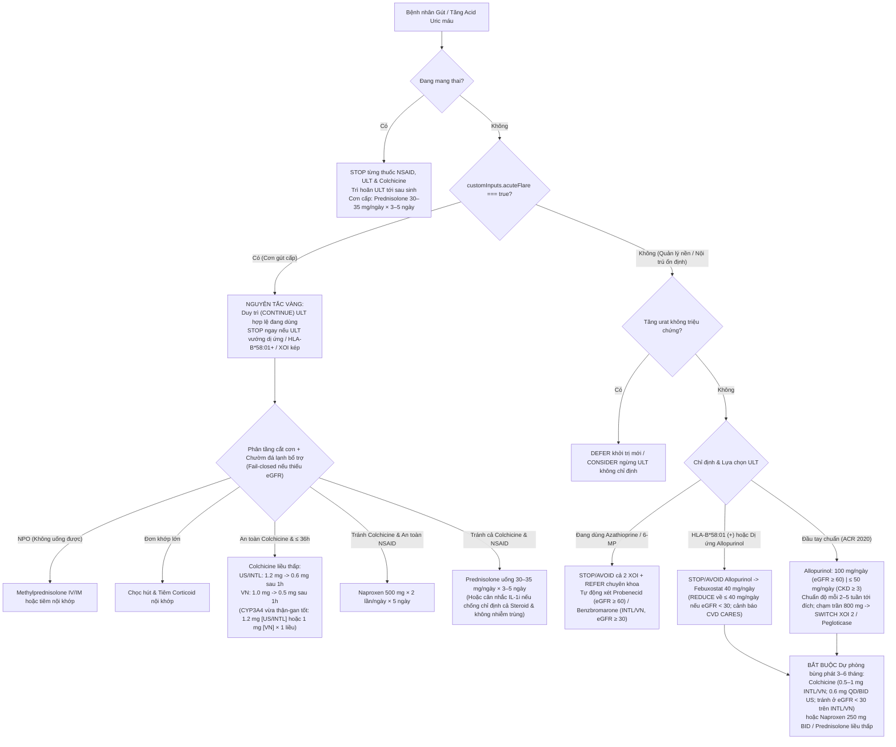

# GDMT-VN – Đặc Tả & Thẩm Định Module Gút & Tăng Acid Uric Máu (`gout`)

**Chuyên khoa:** Cơ Xương Khớp – Thận Tiết Niệu – Nội Tổng Quát  
**Kỹ sư phụ trách:** Agent K (K3) – Chuyên gia Thấp khớp học & Dược lâm sàng GDMT-VN  
**Tiêu chuẩn hướng dẫn & Dược thư:**
- **INTL (Quốc tế):** 2016 EULAR Evidence-Based Recommendations for the Management of Gout (`Ann Rheum Dis 2017;76:29–42`) · 2020 ACR Guideline for the Management of Gout · KDIGO 2024 Clinical Practice Guideline for CKD (Section 3.14)
- **VN (Việt Nam):** Hướng dẫn Chẩn đoán và Điều trị các Bệnh Cơ Xương Khớp – Bộ Y tế Việt Nam (**361/QĐ-BYT** năm 2014) · Hướng dẫn Chẩn đoán và Điều trị Bệnh Thận Mạn – Bộ Y tế (**2388/QĐ-BYT** năm 2024, Bảng 21 & Bảng 22)
- **US (Hoa Kỳ):** 2020 ACR Guideline for the Management of Gout & FDA Prescribing Information (`Zyloprim`, `Uloric` CARES Boxed Warning, `Colcrys` Table 1 CYP3A4/P-gp & Renal Dosing, `Celebrex`)
- **Dược thư châu Âu (EMA/ANSM SmPC):** `Arcoxia` (Etoricoxib) & `Desuric` (Benzbromarone)

---

## 1. Kiến Trúc Mô-đun Hóa (`< 25 KB` mỗi tệp) & Chuẩn An Toàn QA-1 / QA-10

Toàn bộ mã nguồn trong `src/modules/gout/` được tách thành **16 tệp chuyên biệt** (tệp lớn nhất `22,976` bytes, đảm bảo nghiêm ngặt chuẩn `< 25 KB`):
- [`index.ts`](file:///C:/Users/hades/OneDrive/Desktop/New%20folder%20(4)/gdmt-vn/src/modules/gout/index.ts) & [`rules.ts`](file:///C:/Users/hades/OneDrive/Desktop/New%20folder%20(4)/gdmt-vn/src/modules/gout/rules.ts) — Điểm nhập module và bộ điều phối quy tắc theo 7 tầng ưu tiên lâm sàng.
- [`helpers.ts`](file:///C:/Users/hades/OneDrive/Desktop/New%20folder%20(4)/gdmt-vn/src/modules/gout/helpers.ts) & [`helpers.safety.ts`](file:///C:/Users/hades/OneDrive/Desktop/New%20folder%20(4)/gdmt-vn/src/modules/gout/helpers.safety.ts) — Bộ phân tích liều hàng ngày (`parseMedDailyDoseMg` hỗ trợ `BID`/`TID`), so sánh mục tiêu urat theo đơn vị gốc (`µmol/L` vs `mg/dL`), phân tầng chỉ định ULT và các hàm kiểm tra chống chỉ định thuốc.
- [`rules.safety.antiinflam.ts`](file:///C:/Users/hades/OneDrive/Desktop/New%20folder%20(4)/gdmt-vn/src/modules/gout/rules.safety.antiinflam.ts) & [`rules.flare.ts`](file:///C:/Users/hades/OneDrive/Desktop/New%20folder%20(4)/gdmt-vn/src/modules/gout/rules.flare.ts) — Cổng chặn `STOP` độc lập cho từng thuốc NSAID/COX-2i (Triple Whammy, ASCVD/ACS, HFrEF `LVEF < 50%`, bệnh gan, loét/xuất huyết nội sọ cấp, chống đông), kiểm soát độc tính Colchicine, cắt cơn gút cấp (bao gồm NPO tiêm tĩnh mạch/nội khớp, ức chế IL-1, chườm đá lạnh bổ trợ) và bảo toàn ULT hợp lệ trong cơn cấp.
- [`rules.safety.ult.ts`](file:///C:/Users/hades/OneDrive/Desktop/New%20folder%20(4)/gdmt-vn/src/modules/gout/rules.safety.ult.ts), [`rules.ult.ts`](file:///C:/Users/hades/OneDrive/Desktop/New%20folder%20(4)/gdmt-vn/src/modules/gout/rules.ult.ts) & [`rules.uricosuric.ts`](file:///C:/Users/hades/OneDrive/Desktop/New%20folder%20(4)/gdmt-vn/src/modules/gout/rules.uricosuric.ts) — Chặn trùng lặp 2 thuốc XOI (`Allopurinol + Febuxostat`), dừng ngay thuốc dị ứng/quá mẫn, sàng lọc `HLA-B*58:01`, chặn tương tác suy tủy `Azathioprine / 6-MP` kèm mở lối thoát tự động sang Probenecid/Benzbromarone, chuẩn độ Treat-to-Target có kiểm tra trần liều tối đa & trần suy thận, và leo thang Pegloticase khi gút tophi kháng trị.
- [`rules.prophylaxis.ts`](file:///C:/Users/hades/OneDrive/Desktop/New%20folder%20(4)/gdmt-vn/src/modules/gout/rules.prophylaxis.ts), [`rules.concurrent.ts`](file:///C:/Users/hades/OneDrive/Desktop/New%20folder%20(4)/gdmt-vn/src/modules/gout/rules.concurrent.ts) & [`rules.inpatient.ts`](file:///C:/Users/hades/OneDrive/Desktop/New%20folder%20(4)/gdmt-vn/src/modules/gout/rules.inpatient.ts) — Cổng an toàn thai kỳ theo từng hoạt chất, dự phòng bùng phát 3–6 tháng khi khởi trị/chuẩn độ cả XOI lẫn Uricosuric, tối ưu thuốc đồng mắc (Thiazide → Losartan hoặc Amlodipine khi `K+ > 5.0 mmol/L`, Fenofibrate, SGLT2i, Aspirin), và đối chiếu thuốc nội trú fail-closed.
- [`inputs.ts`](file:///C:/Users/hades/OneDrive/Desktop/New%20folder%20(4)/gdmt-vn/src/modules/gout/inputs.ts), [`matrix.ts`](file:///C:/Users/hades/OneDrive/Desktop/New%20folder%20(4)/gdmt-vn/src/modules/gout/matrix.ts), [`pathway.ts`](file:///C:/Users/hades/OneDrive/Desktop/New%20folder%20(4)/gdmt-vn/src/modules/gout/pathway.ts) & [`presets.ts`](file:///C:/Users/hades/OneDrive/Desktop/New%20folder%20(4)/gdmt-vn/src/modules/gout/presets.ts) — Giao diện nhập liệu lâm sàng đầy đủ, ma trận thận 11 thuốc × 7 cột KDIGO (kể cả HD/PD), lộ trình 5 bước và 6 ca mẫu điển hình.

---

## 2. Lưu Đồ Quyết Định Lâm Sàng Module Gút (`gout`)

---

## 3. So Sánh Đa Hồ Sơ (`INTL` vs `VN` vs `US`)

| Tình huống lâm sàng | `INTL` (EULAR 2016 / KDIGO 2024) | `VN` (BYT 361/2014 & BYT CKD 2024) | `US` (ACR 2020 & FDA Labels) |
|---|---|---|---|
| **Liều Colchicine cắt cơn cấp** | `1.2 mg` → `0.6 mg` sau `1 giờ` (đối chiếu EULAR `1.0 + 0.5 mg`; CYP3A4 vừa: `1.2 mg × 1 liều`) | `1 mg` → `0.5 mg` sau `1 giờ` theo viên `1 mg` tại VN (CYP3A4 vừa: `1 mg × 1 liều`) | `1.2 mg` → `0.6 mg` sau `1 giờ` (CYP3A4 vừa: `1.2 mg × 1 liều`, không lặp lại trước `3 ngày`) |
| **Dự phòng Colchicine ở CKD G4 (`eGFR 15–29`)** | **Tránh Colchicine** (`GFR < 30`), chuyển sang Prednisolone liều thấp | **Tránh Colchicine** (viên `1 mg` không chia `0.3 mg`), ưu tiên Prednisolone liều thấp | Khởi đầu `0.3 mg/ngày` (nửa viên `0.6 mg` theo nhãn FDA) nếu không kèm Statin/CYP3A4i |
| **Thời điểm mở đầu ULT trong cơn cấp** | Khởi trị sớm kèm chống viêm đầy đủ | **Trì hoãn `1–2 tuần` (`DEFER`)** tới khi cơn viêm khớp cấp thuyên giảm | Cho phép khởi trị ngay trong cơn cấp kèm chống viêm cắt cơn |
| **Đích Acid Uric khi có Tophi / Hủy khớp** | **`< 300 µmol/L` (`< 5.0 mg/dL`)**; tránh duy trì `< 3 mg/dL` dài hạn | **`< 320 µmol/L`** (`< 360 µmol/L` nếu chưa có tophi) | **`< 360 µmol/L` (`< 6.0 mg/dL`)** chuẩn cho mọi bệnh nhân dùng ULT |
| **Nhóm thuốc tăng thải Urat (Uricosuric)** | Probenecid (`eGFR ≥ 60`) hoặc Benzbromarone (`eGFR ≥ 30`, giám sát AST/ALT) | Chống chỉ định khi có tophi, sỏi thận, `eGFR < 30`, cao tuổi hoặc urat niệu `> 600 mg/24h` | Chỉ dùng Probenecid (`eGFR ≥ 60`); **chặn Benzbromarone** & **Etoricoxib** (không được FDA phê duyệt) |

---

## 4. Kết Quả Kiểm Định Tự Động Toàn Diện (Sau Remediation Vòng 1)

| Hạng mục kiểm định | Quy mô kiểm thử | Kết quả đạt được | Chi tiết đảm bảo chất lượng |
|---|---|---|---|
| **Kích thước tệp mô-đun** (`src/modules/gout/*.ts`) | **16 tệp TypeScript** | **16/16 `< 25 KB`** | Tệp lớn nhất `rules.ult.ts` = `22,976` bytes. |
| **Knowledge Base & Citations** (`npm run verify:kb`) | **72 Citations · 79 Thresholds · 11 Drugs** | **0 Lỗi · 0 Cảnh báo** | 100% trích dẫn khớp nguyên văn PDF; 100% Threshold có `quantity` chuẩn QA-10; 90 file `kb/review/*.json` đồng bộ SHA-256 (`auto_checked`). |
| **Static RulesLint (QA-1, QA-7, QA-8, QA-10)** | **16 files** trong `src/modules/gout/` | **0 Lỗi · 0 Cảnh báo** | `defaultNumberErrors=0`, `moduleConstErrors=0`, `qa10QuantityMismatchErrors=0`, `literalThresholdWarnings=0`, `literalInTextWarnings=0`, `doseNotInCitationWarnings=0`. |
| **Golden Cases** (`tests/golden/gout/*.json`) | **42 ca chuẩn lâm sàng** (85 tests) | **85/85 PASS (100%)** | Bao phủ toàn bộ 30 ca gốc + 12 ca hồi quy Vòng 1 (`gout_31`..`gout_42`: XOI kép, dị ứng Allopurinol đang uống, nội trú ổn định fail-closed, Triple Whammy, ACS + Etoricoxib, xuất huyết nội sọ + Aspirin, HCTZ + tăng K+ → Amlodipine, kịch trần Allopurinol 800 mg, giảm liều Febuxostat 80→40 mg ở CKD G4, biên đơn vị `6.0 mg/dL`, NPO tiêm Methylprednisolone + chườm đá, Azathioprine → Probenecid + hội chẩn). |
| **Property-Based Safety & Fail-Closed** (`tests/modules/gout/invariants.test.ts`) | **15.000 ca ngẫu nhiên hóa xác định** | **15.000/15.000 PASS (0 vi phạm)** | Suite 1 (10.000 ca × 16 bất biến an toàn) + Suite 2 (5.000 ca xóa ngẫu nhiên `SCr/eGFR`, `uricAcid`, `goutFlaresYear` — 0 kê đơn mù). |
