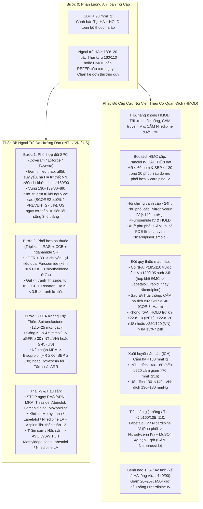

# GDMT-VN – Đặc Tả Module Tăng Huyết Áp (HTN.md)

**Mã định danh:** `htn`  
**Tên module:** Tăng huyết áp (*Hypertension*)  
**Kỹ sư chuyên trách:** Agent H / H2 (Chuyên gia Tim mạch – Tăng huyết áp kiêm Kỹ sư GDMT-VN)  
**Nguồn tài liệu nền tảng:**  
- **INTL:** *2024 ESC Guidelines for the management of elevated blood pressure and hypertension* (*Eur Heart J* 2024;45:3912–4018) + *2021 KDIGO Clinical Practice Guideline for the Management of Blood Pressure in Chronic Kidney Disease* + *2025 ESC Clinical Consensus Statement on Mental Health and Cardiovascular Disease / Hypertensive Emergencies*.
- **VN:** *Khuyến cáo Chẩn đoán và Điều trị Tăng huyết áp của Phân hội Tăng huyết áp Việt Nam / Hội Tim mạch học Việt Nam (VSH/VNHA 2022)* & *Bộ Y tế Quyết định 3192/QĐ-BYT Hướng dẫn chẩn đoán và điều trị tăng huyết áp*.
- **US:** *2025 AHA/ACC/AANP/AAPA/ABC/ACCP/ACPM/AGS/AMA/ASPC/NMA/PCNA/SGIM Guideline for the Prevention, Detection, Evaluation, and Management of High Blood Pressure in Adults*.
- **Nhãn thuốc & Dược điển:** Nhãn FDA DailyMed (Norvasc/Amlodipine, Cardene IV/Nicardipine, Brevibloc/Esmolol, Nipride/Sodium Nitroprusside, Cleviprex/Clevidipine, Aldomet/Methyldopa, Catapres/Clonidine, Cardura/Doxazosin) & SmPC EMA (Natrilix SR/Indapamide, Coversyl/Perindopril, Zanidip/Lercanidipine, Physiotens/Moxonidine, Ebrantil/Urapidil) + *ESC Heart Failure Guidelines* (cảnh báo MOXCON & lợi tiểu).

---

## 1. Kiến Trúc Mô-đun Hóa & Sơ Đồ Thuật Toán Điều Trị Toàn Diện

Mã nguồn `src/modules/htn/` được tách thành các phân hệ mô-đun hóa rõ ràng, tuân thủ nghiêm ngặt QA-1, QA-8, QA-9 và QA-10:
- `index.ts` & `inputs.ts` — Đăng ký module, toàn bộ trường đầu vào chuẩn hóa (`registerValidFields`) và 3 nhóm biểu mẫu động.
- `helpers.ts` — Phân nhóm dược lý dùng chung, bộ lọc `getInvalidatedActiveMedIds` / `getEffectiveActiveMedIds` (loại trừ thuốc vừa bị `STOP`/`HOLD`/`SWITCH` khỏi đếm bậc), đích huyết áp cá thể hóa `getUncontrolledBpCutoffs` và cổng phân luồng khủng hoảng ngoại trú.
- `rules.outpatient.safety.ts`, `rules.outpatient.steps.ts`, `rules.outpatient.special.ts` (gộp qua `rules.outpatient.ts`) — Phân luồng cấp cứu ngoại trú, phân loại & đích HBPM/ABPM, rà soát chống chỉ định/tương tác thuốc đang dùng, phác đồ 4 bước SPC, chỉ định bắt buộc chẹn beta, thai kỳ/hậu sản, SGLT2i trên CKD, tầm soát thứ phát (`< 40 tuổi`, ARR) và theo dõi sinh hóa 2–4 tuần (chấp nhận tăng SCr huyết động `≤ 30%`).
- `rules.inpatient.emergency.ts`, `rules.inpatient.neuro_preg.ts` (gộp qua `rules.inpatient.ts`) — Phân định Cơn THA khẩn cấp vs Cấp cứu có HMOD (tách thẻ phân luồng ICU không gắn `drugId` để bảo toàn tuyệt đối đích huyết động chuyên biệt từng cơ quan trong `merge.ts`), Bóc tách ĐMC cấp, Hội chứng vành cấp `< 24h`, Phù phổi cấp huyết động, Đột quỵ thiếu máu não (rtPA / EVT / không rtPA), Xuất huyết não (ICH), Tiền sản giật nặng / Sản giật (kèm `MgSO4` độc lập) và Bệnh não THA / THA ác tính.
- `matrix.ts`, `pathway.ts`, `presets.ts` — Ma trận bệnh đồng mắc (tách HFrEF vs HFpEF, tiền sử phù mạch, hạ HA tư thế), ma trận chỉnh liều thận đủ **18/18 thuốc sở hữu**, lộ trình 4 bước và 5 kịch bản mẫu.

---

## 2. Danh Mục 18 Thuốc Sở Hữu (`kb/drugs/`)

Toàn bộ **18/18 hoạt chất** do Agent H sở hữu đều có đầy đủ `classes`, `vnBrands` thực tế tại Việt Nam, `forms`, `start`/`target`/`titration` không lặp từ trong `fmtDose()`, dải `renal` khớp 100% với `htnRenalMatrix`, `hepatic`, `pregnancy`, `lactation`, `contraindications` máy đọc, `interactions` trọng yếu và `citationIds` nguyên văn từ PDF:

| STT | Hoạt chất | ID | Nhóm chuẩn (`classes`) | Liều khởi đầu chuẩn | Chỉnh liều thận / Chống chỉ định đặc hiệu |
|:---:|---|---|---|---|---|
| 1 | **Amlodipine** | `amlodipine` | `dhp_ccb` | 5 mg x 1 lần/ngày (2,5 mg người già/suy gan) | An toàn mọi mức eGFR (không cần chỉnh liều thận); giới hạn Simvastatin ≤ 20 mg/ngày |
| 2 | **Nifedipine LA** | `nifedipine` | `dhp_ccb` | 30 mg x 1 lần/ngày (viên LA/GITS) | Đầu tay an toàn thai kỳ & cho con bú; **cấm tuyệt đối** ngậm dưới lưỡi / cắn vỡ viên LA |
| 3 | **Felodipine** | `felodipine` | `dhp_ccb` | 5 mg x 1 lần/ngày (2,5 mg người cao tuổi/suy gan) | Không cần chỉnh liều thận; tránh nước bưởi chùm & ức chế mạnh CYP3A4 |
| 4 | **Lercanidipine** | `lercanidipine` | `dhp_ccb` | 10 mg x 1 lần/ngày (trước ăn ≥ 15 phút) | **Chống chỉ định** khi `eGFR < 30`, suy gan nặng, thai kỳ, dùng kèm ức chế mạnh CYP3A4 hoặc Ciclosporin; thức ăn giàu mỡ tăng AUC gấp 4 lần |
| 5 | **Indapamide SR** | `indapamide` | `thiazide_diuretic`, `thiazide_like` | 1,5 mg SR x 1 lần/ngày buổi sáng | **Chống chỉ định** `CrCl/eGFR < 30`, bệnh não gan, hạ K⁺ máu (`< 3,5 mmol/L`); thận trọng Gút & Lithium |
| 6 | **Hydrochlorothiazide** | `hydrochlorothiazide` | `thiazide_diuretic` | 12,5–25 mg x 1 lần/ngày | Không khuyến cáo khi `eGFR < 30` (mất tác dụng, chuyển lợi tiểu quai); tránh ở Gút, thai kỳ |
| 7 | **Chlorthalidone** | `chlorthalidone` | `thiazide_diuretic`, `thiazide_like` | 12,5 mg x 1 lần/ngày | Thận trọng ở CKD G4 (`eGFR 15–29`: có bằng chứng thử nghiệm CLICK giảm HA); chống chỉ định vô niệu / `< 15` |
| 8 | **Doxazosin** | `doxazosin` | `alpha1_blocker` | 1 mg uống buổi tối tại giường | Tránh đơn trị đầu tay do tăng nguy cơ suy tim sung huyết (ALLHAT); cảnh báo ngất liều đầu, cộng hưởng hạ áp với PDE-5i & hội chứng mống mắt mềm (IFIS) |
| 9 | **Methyldopa** | `methyldopa` | `central_alpha2` | 250 mg x 2–3 lần/ngày (tối đa 3 g/ngày thai kỳ) | Kéo dài khoảng cách liều theo thận (`eGFR 30–59`: mỗi 8–12h; `< 30`: mỗi 12–24h); **chống chỉ định** bệnh gan hoạt động, trầm cảm; đổi thuốc sau sinh ≤ 2 ngày |
| 10 | **Clonidine** | `clonidine` | `central_alpha2` | 0,1 mg x 2 lần/ngày | Cảnh báo cơn THA dội ngược nguy kịch nếu ngừng đột ngột (khi dùng kèm chẹn beta phải ngừng BB trước vài ngày rồi mới giảm dần Clonidine) |
| 11 | **Moxonidine** | `imidazoline_agonist` (`moxonidine`) | `imidazoline_agonist` | 0,2 mg x 1 lần/ngày | `eGFR 30–59`: tối đa `0,2 mg/lần` và `0,4 mg/ngày`; **chống chỉ định tuyệt đối** ở Suy tim (MOXCON tăng tử vong), `eGFR < 30`, nhịp chậm / block AV độ 2–3 |
| 12 | **Nicardipine IV** | `nicardipine` | `dhp_ccb` | Truyền TM 5 mg/giờ (tăng 2,5 mg/giờ mỗi 5–15p, tối đa 15 mg/giờ) | Thuốc IV chủ lực cho đột quỵ, xuất huyết não, bệnh não THA; **chống chỉ định** hẹp van động mạch chủ khít nặng |
| 13 | **Labetalol** | `labetalol` | `bb_nonselective`, `alpha1_blocker` | Uống thai kỳ: 100–200 mg x 2 lần/ngày; Cấp cứu TM: bolus ≤ 20 mg hoặc truyền TM (tối đa 300 mg/24h) | Đầu tay số 1 cho cả THA thai kỳ (uống) và tiền sản giật nặng (TM); cấm ở hen/COPD co thắt, phù phổi cấp, block AV độ 2–3, `HR < 60` |
| 14 | **Nitroglycerin IV** | `nitroglycerin` | `nitrate`, `vasodilator` | Truyền TM 5 mcg/phút (tối đa 200 mcg/phút) | Ưu tiên số 1 cho phù phổi cấp do tim, hội chứng vành cấp & tiền sản giật kèm phù phổi; **cấm tuyệt đối** dùng chung PDE-5i, tăng áp lực nội sọ, nhồi máu thất phải |
| 15 | **Urapidil IV** | `urapidil` | `alpha1_blocker`, `vasodilator` | Bolus TM chậm 12,5–25 mg; duy trì 5–40 mg/giờ | Thay thế hiệu quả trong cấp cứu THA chu phẫu / động mạch chủ / đột quỵ; chống chỉ định hẹp eo ĐMC & thời kỳ cho con bú |
| 16 | **Esmolol IV** | `esmolol` | `bb_selective` | Nạp 500–1000 mcg/kg/phút (1p), duy trì 50–300 mcg/kg/phút | Hàng đầu khống chế `dP/dt` trong bóc tách ĐMC cấp (`t½ ~9 phút`); chống chỉ định phù phổi cấp, block AV độ 2–3, phối hợp Verapamil/Diltiazem TM |
| 17 | **Sodium nitroprusside** | `sodium_nitroprusside` | `vasodilator` | Truyền TM 0,3 mcg/kg/phút (tối đa 10 mcg/kg/phút trong ≤ 10 phút) | **Chống chỉ định tuyệt đối** trong thai kỳ (ngộ độc cyanide thai nhi), tránh trong hội chứng vành cấp (cướp máu mạch vành) và tăng áp lực nội sọ / bệnh mạch não cấp |
| 18 | **Clevidipine IV** | `clevidipine` | `dhp_ccb` | Truyền TM 1–2 mg/giờ (tối đa 21 mg/giờ) | Nhũ tương lipid: **chống chỉ định** dị ứng đậu nành/trứng, rối loạn chuyển hóa lipid nặng và hẹp khít van động mạch chủ |

---

## 3. Phân Kỳ Đa Hướng Dẫn (`profileDiff`: INTL vs VN vs US)

| Tiêu chí lâm sàng | `INTL` (ESC 2024 / KDIGO 2021) | `VN` (VSH/VNHA 2022 & BYT 3192) | `US` (AHA/ACC 2025) |
|---|---|---|---|
| **Phân loại HA phòng khám** | 3 mức: Không tăng (`<120/70`), Huyết áp tăng (`120–139/70–89`), Tăng huyết áp (`≥140/90`) | Bình thường/Tối ưu (`<130/85`), Bình thường-cao (`130–139/85–89`), Độ 1 (`140–159/90–99`), Độ 2 (`≥160/100`), Độ 3 (`≥180/110`) | Bình thường (`<120/<80`), Huyết áp tăng (`120–129/<80`), Giai đoạn 1 (`130–139/80–89`), Giai đoạn 2 (`≥140/90`) |
| **Chiến lược khởi trị Bước 1** | `≥140/90`: Viên phối hợp đôi SPC; `130–139/80–89` nguy cơ cao (`SCORE2 ≥10%` / bệnh đồng mắc): đơn trị sau 3 tháng lối sống | `<80 tuổi` có `≥140/90`: Viên phối hợp đôi SPC ngay từ Độ 1 (Bảng 9 VSH 2022); **`≥80 tuổi`: chỉ khởi trị đơn trị khi `≥160/90 mmHg`** | `≥140/90` (GĐ 2): Viên phối hợp đôi SPC (COR 1); `130–139/80–89` (GĐ 1): đơn trị ngay nếu nguy cơ cao (`PREVENT ≥7,5%`), hoặc **lối sống 3–6 tháng** nếu `PREVENT <7,5%` |
| **Đích huyết áp ngoại trú** | **120–129 / 70–79 mmHg** nếu dung nạp; CKD có `eGFR >30`: 120–129 (KDIGO chuẩn hóa `<120`); nới lỏng `<140/90` nếu `≥85t` / suy yếu / hạ HA tư thế | **< 130/80 mmHg** cho nguy cơ cao `<70 tuổi`; **< 140/80 mmHg** chung (VSH 2022; `<140/90` ở `≥80 tuổi` / suy yếu) | **< 130/80 mmHg** chuẩn; nới lỏng cá thể hóa `<140/90` khi suy yếu nặng / kỳ vọng sống ngắn / hạ HA tư thế |
| **Cổng eGFR khởi trị Spironolactone kháng trị** | **`eGFR ≥ 30 mL/min/1.73m²`** & `K⁺ ≤ 4,5` (Class IIa; liều thấp 12,5 mg khi eGFR 30–44) | **`eGFR ≥ 30 mL/min/1.73m²`** & `K⁺ ≤ 4,5` (Class I) | **`eGFR ≥ 45 mL/min/1.73m²`** & `K⁺ ≤ 4,5` (COR 1, Table 13) |
| **Thai kỳ (Ngưỡng/Đích & Aspirin)** | Khởi trị `≥140/90`, đích `<140/90` (giữ `DBP ≥80`); Aspirin **100–150 mg** tối từ tuần 12 | Khởi trị `≥140/85–90`, đích **`<140/85`** (không hạ `SBP <110`); Aspirin **75–162 mg** | Khởi trị `≥140/90`, đích `<140/90`; Aspirin **81 mg/ngày** từ tuần 12 đến khi sinh |
| **Đột quỵ thiếu máu não không rtPA & Xuất huyết não (ICH)** | AIS không rtPA: hạ 15%/24h khi **`≥220/110`**; ICH: đích **140–160 mmHg**, nếu `SBP ≥220` **cấm giảm >70 mmHg/1h** | AIS không rtPA: hạ 15% khi **`>220/120`**; ICH: đích **130–180 mmHg** | AIS không rtPA: hạ 15%/24h khi **`≥220/120`** (sau EVT cấm `<140`); ICH: đích **130–<140 mmHg** (cấm `<130`) |

---

## 4. Đầu Vào Lâm Sàng Động (`src/modules/htn/inputs.ts`)

1. **Theo dõi HA ngoại trú & Nguy cơ (`htn_outpatient_monitoring`):**
   - `customInputs.homeSbp`, `customInputs.homeDbp` (HBPM ngưỡng `≥ 135/85 mmHg` phát hiện THA áo choàng trắng & THA ẩn giấu).
   - `customInputs.abpm24hSbp`, `customInputs.abpm24hDbp` (Holter ABPM 24 giờ ngưỡng `≥ 130/80 mmHg`).
   - `customInputs.score2RiskPercent` (SCORE2 / SCORE2-OP 10 năm, %), `customInputs.preventRiskPct` (AHA PREVENT 10 năm, %).
   - `conditions.orthostaticHypotension`, `conditions.frailty`, `conditions.limitedLifespan`.
2. **Tầm soát thứ phát & Cổng an toàn đặc hiệu (`htn_secondary_screening`):**
   - `conditions.unprovokedHypokalemia`, `conditions.renalBruit`, `conditions.snoringOsa`, `conditions.suspectedSecondaryHtn` (khởi phát `< 40 tuổi` theo ESC 2024).
   - `conditions.priorAngioedema`, `customInputs.bilateralRenalArteryStenosis`.
   - `customInputs.postpartum` (Giai đoạn hậu sản), `customInputs.severeAorticStenosis` (Hẹp khít van ĐMC), `customInputs.avBlock2or3`, `customInputs.pacemaker`.
3. **Bối cảnh Nội viện – Tổn thương cơ quan đích cấp (`htn_inpatient_emergency_hmod`):**
   - `conditions.aorticDissection`, `conditions.acuteAcsWithin24h`, `conditions.acutePulmonaryEdema`, `conditions.acuteIschemicStroke`, `conditions.thrombolysisEligible`, `customInputs.postReperfusionEvt`, `conditions.acuteIntracerebralHemorrhage`, `conditions.severePreeclampsiaEclampsia`, `conditions.hypertensiveEncephalopathy`, `conditions.malignantHypertension`, `conditions.perioperativeHypertension`, `customInputs.pde5InhibitorUse`.

---

## 5. Kiểm Định Chất Lượng Sau Khắc Phục Round 1

- **Cơ sở tri thức (`kb/`):** **125 trích dẫn nguyên văn** (`kb/citations/htn.json`) đã kiểm chứng từng chữ trên PDF gốc, **155 ngưỡng lâm sàng định danh ngữ nghĩa QA-10** (`kb/thresholds/htn.json`), **18 hồ sơ thuốc sở hữu** và **173 hồ sơ `kb/review/*.json`** (`status: "auto_checked"`).
- **`npm run verify:kb` & `npx tsc --noEmit`:** **0 lỗi TypeScript**, **0 lỗi và 0 cảnh báo `verify:kb`** trên toàn bộ module `htn` và 18 thuốc sở hữu.
- **Bộ 53 Ca Lâm Sàng Chuẩn (`tests/golden/htn/`, yêu cầu `≥ 52`):** **54/54 tests PASS (100%)** trong `tests/modules/htn/golden.test.ts` và **108/108 tests PASS** trên `tests/golden/_runner.test.ts -t "htn|hypertensive"`.
- **Bộ Kiểm Thử Đối Kháng R2 & R3 (`r2_verify_runtime` & `r3_adversarial.ts`):** Toàn bộ **75 kịch bản đối kháng + 5 presets + 6 ca biên R2 (`C4b`, `C4c`, `C7b`, `C8b`, `C8c`, `C11`)** vận hành an toàn tuyệt đối trên cả 3 profile.
- **30.000 Ca Kiểm Thử Bất Biến Ngẫu Nhiên (`tests/modules/htn/invariants.test.ts`):** **15.000 ca Suite 1 (10 nhóm bất biến an toàn đa profile) + 15.000 ca Suite 2 (Fail-closed xóa ngẫu nhiên biến bắt buộc): 0 vi phạm (100% PASS)**.
