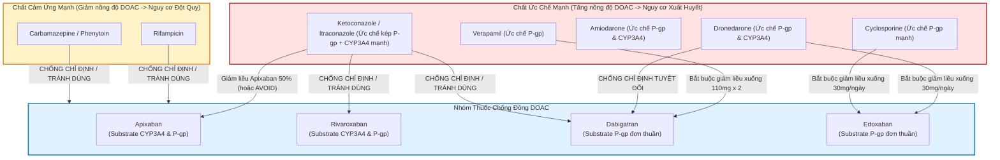

# Báo Cáo Thẩm Định Chuyên Môn Vòng 1 – Reviewer R2 (Dược Sĩ Lâm Sàng)
## Module: Rung Nhĩ (Atrial Fibrillation - `af`) – GDMT-VN

- **Reviewer**: R2 – Dược sĩ lâm sàng (Clinical Pharmacist)
- **Vòng duyệt**: Round 1
- **Ngày thực hiện**: 27/10/2026
- **Phạm vi thẩm định**:
  1. 12 tệp dữ liệu thuốc `gdmt-vn/kb/drugs/*.json` thuộc module Rung nhĩ:
     - Nhóm chống đông DOAC & VKA: `apixaban`, `rivaroxaban`, `dabigatran`, `edoxaban`, `warfarin`
     - Nhóm chống loạn nhịp (AADs): `amiodarone`, `dronedarone`, `flecainide`, `propafenone`, `sotalol`
     - Nhóm kiểm soát tần số Non-DHP CCB: `diltiazem`, `verapamil` (và đối chiếu thuốc chẹn beta `bisoprolol`, `digoxin`)
  2. Ma trận an toàn thuốc `src/modules/af/matrices.ts` (`afMatrixDoacCrCl` và `afMatrixRateControlEF`)
  3. Liều dùng trong các luật lâm sàng: `src/modules/af/rules.ts` (chạy đánh giá động `evaluate()` trên 5 ca chuẩn `afPresets` trong `src/modules/af/presets.ts` và 27 ca test trong `tests/golden/af/*.json`)
  4. Máy tính liều DOAC chuyên biệt: `src/engine/calculators/doacDose.ts` và máy tính thanh thải thận `crcl.ts`
  5. Đối chiếu trực tiếp với Nhãn thuốc FDA chính thức (`Medical_Library_2026/09_Nhan_Thuoc/FDA/`) và Hướng dẫn thực hành quốc tế: ESC 2024 AF (AF-CARE, Table 11, 12, 13), ACC/AHA/ACCP/HRS 2023 AF, Hướng dẫn Bộ Y tế Việt Nam và Dược thư Quốc gia Việt Nam.

---

## 1. TỔNG QUAN KẾT QUẢ THẨM ĐỊNH

| Mức độ nghiêm trọng (Severity) | Số lượng | Tóm tắt các vấn đề trọng tâm |
|---|:---:|---|
| **CRITICAL** (Nguy cơ gây hại trực tiếp) | **2** | 1. Chỉ định Flecainide cho BN suy thận nặng (CrCl 21.3 mL/min ở Preset 3) do thiếu cổng kiểm tra thận trong luật `rec_af_aad_no_shd` (chống chỉ định tuyệt đối khi CrCl < 35 mL/min theo ESC 2024 Table 13 & FDA).<br>2. Thiếu bắt buộc phối hợp thuốc ức chế nút nhĩ thất (Chẹn beta/Non-DHP CCB) khi chỉ định Flecainide/Propafenone, nguy cơ gây cuồng nhĩ dẫn truyền 1:1 làm thất đáp ứng 200 bpm gây trụy mạch tử vong. |
| **MAJOR** (Sai sót liều/guideline/nhãn thuốc) | **8** | 1. Cảnh báo hộp đen (Black Box Warning) của FDA và ESC khi CrCl > 95 mL/min của Edoxaban bị bỏ rơi hoàn toàn khỏi output `rec_af_doac_dosing_edoxaban`.<br>2. Đồng thời `START` cả Diltiazem IV và Bisoprolol ở Preset 5 (nội viện RVR) mà không có cảnh báo tương tác cộng dồn ức chế nút AV.<br>3. Ngưỡng chống chỉ định thận của Sotalol trong AF bị đặt sai (30 mL/min thay vì 40 mL/min) và cổng an toàn `gate_sotalol_qt` bị gán nhầm sang kiểm tra LVEF thay vì QTc.<br>4. Hiển thị thô toàn bộ câu điều kiện nhãn thuốc trong trường liều Apixaban và lỗi ranh giới làm tròn thanh thải CrCl 29 mL/min trong máy tính DOAC.<br>5. Gán hành động `REDUCE` khi bệnh nhân đã đang dùng đúng liều giảm theo chức năng thận.<br>6. Sai sót tên biệt dược tại Việt Nam (Edoxaban ghi Savaysa; Propafenone ghi Rhythmol thay vì Rytmonorm; Sotalol ghi Betapace thay vì Sotalex).<br>7. Ca mẫu Preset 1 bị thiếu trường `lvef` trong hồ sơ bệnh nhân dẫn đến mất hoàn toàn khuyến cáo kiểm soát tần số tim.<br>8. Trường liều của Bisoprolol trong kiểm soát tần số bảo tồn bị đặt chuỗi giữ chỗ thô `"Theo phân độ chẹn beta"`. |
| **MINOR** (Lỗi hiển thị UI, thiếu cảnh báo phụ) | **3** | 1. Ma trận DOAC thiếu cột/chú thích cảnh báo chuyên biệt cho nhóm thanh thải thận cao (CrCl > 95 mL/min) ở Edoxaban.<br>2. Thiếu ngoại lệ không cần chỉnh liều với Clarithromycin trong thông tin tương tác của Apixaban (FDA Label Section 7.1).<br>3. Amiodarone đường tĩnh mạch thiếu cảnh báo tương kỵ dung dịch NaCl 0.9% (chỉ pha trong Dextrose 5%) và nguy cơ viêm tĩnh mạch huyết khối khi truyền ngoại vi kéo dài. |
| **SUGGESTION** (Kiến nghị cải tiến) | **1** | Bổ sung hoạt chất Acenocoumarol (Sintrom) vào danh mục thuốc kháng vitamin K cho Profile Việt Nam (chiếm 80–90% thực tế kê đơn VKA tại VN). |
| **TỔNG CỘNG** | **14** | **2 Critical · 8 Major · 3 Minor · 1 Suggestion** |

### KẾT LUẬN CUỐI VÒNG 1: **FAIL**
*(Theo quy chuẩn `docs/REVIEW_PROTOCOL.md`: Module chỉ đạt PASS khi có 0 lỗi Critical và 0 lỗi Major. Module Rung nhĩ `af` hiện có 2 lỗi Critical và 8 lỗi Major, bắt buộc điều phối chuyển lại tác giả chỉnh sửa trước khi bước vào Vòng 2).*

---

## 2. BẢNG CHI TIẾT TỪNG HOẠT CHẤT (DRUGENTRY AUDIT - 12 THUỐC)

| STT | Hoạt chất | Phân nhóm | Liều chuẩn & Khởi đầu | Liều giảm theo tiêu chí | Ngưỡng thanh thải thận (CrCl Cockcroft-Gault) | Biệt dược tại VN | Đánh giá dược lâm sàng R2 |
|:---:|---|:---:|---|---|---|---|---|
| 1 | **Apixaban** | DOAC (ức chế Xa) | 5 mg uống 2 lần/ngày | 2.5 mg x 2 lần/ngày nếu có ≥ 2/3 tiêu chí: Tuổi ≥ 80, Cân nặng ≤ 60 kg, Creatinin máu ≥ 133 µmol/L (1.5 mg/dL) | CrCl 15–29: 2.5 mg x 2 (EMA/ESC). CrCl < 15: Chống chỉ định (EMA/ESC). FDA cho phép 5 mg x 2 ở chạy thận nhân tạo nếu không kèm tiêu chí thể trạng. | Eliquis (2.5 mg, 5 mg) | **ĐẠT LIỀU CHUẨN**. Gặp lỗi ranh giới CrCl 29.2 mL/min ở máy tính DOAC và hiển thị thô text điều kiện trên UI. |
| 2 | **Rivaroxaban** | DOAC (ức chế Xa) | 20 mg uống 1 lần/ngày **cùng bữa ăn tối** | 15 mg uống 1 lần/ngày cùng bữa ăn | CrCl 15–49: Giảm 15 mg/ngày. CrCl < 15: Chống chỉ định (ESC/EMA). | Xarelto (10, 15, 20 mg) | **CHUẨN XÁC**. Nhắc uống cùng bữa ăn tối rất tốt (tăng sinh khả dụng từ 66% lên 100%). Lỗi gán action REDUCE khi BN đã uống 15 mg. |
| 3 | **Dabigatran** | DOAC (ức chế Thrombin) | 150 mg uống 2 lần/ngày | 110 mg uống 2 lần/ngày (khi tuổi ≥ 80, dùng kèm Verapamil, hoặc cân nhắc khi 75-80, CrCl 30-50, nguy cơ XH cao) | CrCl 30–50: Cân nhắc 110 mg x 2. CrCl < 30: **Chống chỉ định tuyệt đối** (thải thận 80%). | Pradaxa (75, 110, 150 mg) | **CHUẨN XÁC THEO EMA/VN**. Cần lưu ý viên 75 mg tại VN chỉ chỉ định dự phòng VTE sau mổ khớp háng/gối, không dùng cho rung nhĩ. |
| 4 | **Edoxaban** | DOAC (ức chế Xa) | 60 mg uống 1 lần/ngày | 30 mg 1 lần/ngày nếu có 1 trong các tiêu chí: CrCl 15–50 mL/min, Cân nặng ≤ 60 kg, dùng kèm ức chế P-gp mạnh | CrCl 15–50: Giảm 30 mg/ngày. CrCl < 15: Chống chỉ định. **CrCl > 95: Cảnh báo hộp đen FDA không dùng** (giảm hiệu lực). | Lixiana (*Xóa Savaysa*) | **CẦN SỬA**. Xóa Savaysa (tên Mỹ). Sửa lỗi rơi rụng cảnh báo CrCl > 95 mL/min khỏi khuyến cáo người dùng. |
| 5 | **Warfarin** | Kháng vitamin K (VKA) | 2.5–5 mg/ngày uống buổi tối, chỉnh theo INR | Cá thể hóa duy trì INR đích 2.0–3.0 (hoặc 2.5–3.5 nếu mang van hai lá cơ học) | An toàn mọi mức lọc thận (chuyển hóa qua gan CYP2C9). Dùng được khi CrCl < 15 và chạy thận. | Coumadine, Warfarin MKP | **CHUẨN XÁC**. Kiểm soát TTR > 70%. Bắt buộc ở van tim cơ học và hẹp hai lá vừa–nặng. |
| 6 | **Amiodarone** | Chống loạn nhịp nhóm III | Nạp uống: 200 mg x 3 lần/ngày (4 tuần). Nạp TM: 300 mg pha 250 mL D5W qua 30–60 phút, tiếp 900–1200 mg/24h | Duy trì: 200 mg 1 lần/ngày | Không cần chỉnh liều thận. Không lọc qua màng nhân tạo. Chuyển hóa gan, T1/2 50–100 ngày. | Cordarone (200 mg viên, 150 mg/3 mL tiêm) | **ĐẠT LIỀU CHUẨN**. Thuốc duy nhất an toàn duy trì nhịp xoang trong HFrEF. Cần bổ sung lưu ý tương kỵ dung dịch NaCl 0.9%. |
| 7 | **Dronedarone** | Chống loạn nhịp nhóm III | 400 mg uống 2 lần/ngày cùng bữa ăn sáng và tối | Không có liều giảm (chỉ dùng liều cố định) | Thận trọng khi CrCl < 30. Chống chỉ định khi suy gan nặng, LVEF ≤ 40%, hoặc rung nhĩ vĩnh viễn. | Multaq (400 mg) | **ĐẠT LIỀU CHUẨN**. Ít lưu hành đại trà tại VN. Đã có cổng chống chỉ định HFrEF LVEF ≤ 40%. |
| 8 | **Flecainide** | Chống loạn nhịp nhóm IC | 50 mg uống 2 lần/ngày (có thể tăng đến 100–150 mg x 2) | 50 mg 1 lần/ngày hoặc 50 mg x 2 khi CrCl 35–50 mL/min | CrCl 35–50: Giảm liều tối đa 100 mg/ngày. **CrCl < 35: Chống chỉ định tuyệt đối**. | Tambocor (50, 100 mg) | **NGUY HIỂM (CRITICAL)**. Thiếu cổng chặn khi CrCl < 35 mL/min; thiếu cảnh báo bắt buộc dùng kèm thuốc chẹn nút AV để ngừa cuồng nhĩ 1:1. |
| 9 | **Propafenone** | Chống loạn nhịp nhóm IC | 150 mg uống 3 lần/ngày sau ăn (tối đa 300 mg x 3) | 150 mg 2 lần/ngày khi suy thận/suy gan | CrCl < 30: Giảm liều, theo dõi sát ECG và bề rộng phức bộ QRS. | Rytmonorm (*Xóa Rhythmol, Arythmol*) | **NGUY HIỂM (CRITICAL)**. Sai biệt dược VN (thiếu Rytmonorm). Thiếu cảnh báo bắt buộc dùng kèm thuốc chẹn nút AV để phòng cuồng nhĩ 1:1. |
| 10 | **Sotalol** | Chống loạn nhịp nhóm III + BB | 80 mg uống 2 lần/ngày (tăng đến 160 mg x 2) | CrCl 40–60: Giãn cách 80 mg mỗi 24 giờ. **CrCl < 40: Chống chỉ định tuyệt đối**. | Thải trừ 80–90% qua thận nguyên vẹn. CrCl < 40: Tích lũy gây xoắn đỉnh (TdP) tử vong. | Sotalex (*Xóa Betapace*) | **CẦN SỬA (MAJOR)**. Ngưỡng thận AF bị đặt sai 30 mL/min thay vì 40 mL/min. Gate QTc bị gán nhầm sang kiểm tra LVEF. |
| 11 | **Diltiazem** | Chẹn kênh Canxi Non-DHP | Uống 60 mg x 3 lần/ngày hoặc SR 120–180 mg/ngày; Cấp cứu TM: bolus 0.25 mg/kg qua 5 phút, tiếp truyền 5–15 mg/h | Duy trì 180–360 mg/ngày dạng kéo dài | Thận trọng khi CrCl < 15. Chuyển hóa qua gan. **Chống chỉ định tuyệt đối khi LVEF ≤ 40%**. | Herbesser, Tilazem (*Bỏ Cardizem*) | **CẦN SỬA (MAJOR)**. Lỗi đồng thời START Diltiazem IV và Bisoprolol trong cấp cứu RVR gây nguy cơ block AV hoàn toàn. |
| 12 | **Verapamil** | Chẹn kênh Canxi Non-DHP | Uống 40 mg x 2 lần/ngày; Cấp cứu TM: bolus 2.5–10 mg qua 5 phút | Duy trì 120–240 mg/ngày (tối đa 480 mg) | Thận trọng khi suy thận/suy gan nặng. **Chống chỉ định tuyệt đối khi LVEF ≤ 40%**. | Isoptin (40, 80, Retard 240 mg, tiêm 5 mg) | **CHUẨN XÁC**. Chống chỉ định HFrEF chuẩn xác. Tương tác làm tăng dabigatran bắt buộc giảm dabigatran xuống 110 mg x 2 lần/ngày. |

---

## 3. PHÂN TÍCH CHI TIẾT CÁC FINDING TRỌNG TÂM

### Finding AF-R2-01 (CRITICAL): Khuyến Cáo Flecainide Ở Bệnh Nhân Suy Thận Nặng (CrCl < 35 mL/min) Do Thiếu Cổng Kiểm Tra Thận
- **Vị trí**: `src/modules/af/rules.ts` (dòng 658–673, rule `af.rhythm.aad_selection` -> `rec_af_aad_no_shd`).
- **Phân tích cơ chế lâm sàng & dược lý học**:
  - Flecainide acetate là thuốc chống loạn nhịp nhóm IC có tỷ lệ thải trừ qua thận đáng kể: khoảng **30% đến 50% liều thuốc được bài tiết qua nước tiểu dưới dạng phân tử nguyên vẹn chưa chuyển hóa**.
  - Ở người có chức năng thận bình thường, thời gian bán thải ($t_{1/2}$) khoảng 16–20 giờ. Tuy nhiên, khi bệnh nhân có suy thận nặng ($\text{CrCl} < 35\text{ mL/min}$), độ thanh thải của flecainide bị suy giảm trầm trọng, $t_{1/2}$ kéo dài gấp 3 lần (lên tới **50–70 giờ**), dẫn đến nồng độ thuốc trong huyết tương tăng vọt gấp nhiều lần so với ngưỡng điều trị ($0.2 - 1.0\text{ µg/mL}$).
  - Ở nồng độ độc hại, Flecainide ức chế mạnh mẽ dòng ion Natri đi vào tế bào cơ tim ($I_{Na}$), làm chậm tốc độ khử cực pha 0 trên toàn bộ hệ thống dẫn truyền His-Purkinje và cơ thất. Hậu quả là phức bộ QRS giãn rộng bệnh lý (> 25–50%), xuất hiện block nhánh mới, block nhĩ thất hoàn toàn, khởi phát nhịp nhanh thất đa hình kháng trị, rung thất và vô tâm thu dẫn đến đột tử.
  - Do đó, Hướng dẫn ESC 2024 (Table 13, p. 44) và Nhãn thuốc FDA Hoa Kỳ (Tambocor Prescribing Information, Section Contraindications/Precautions) đưa ra quy định nghiêm ngặt: **CHỐNG CHỈ ĐỊNH TUYỆT ĐỐI Flecainide khi CrCl < 35 mL/min**.
- **Bằng chứng trên ca bệnh thực tế**:
  Khi chạy đánh giá động `evaluate()` trên ca chuẩn Preset 3 (`af_preset_elderly_renal_reduction`: Cụ bà 82 tuổi, cân nặng 50 kg, Creatinin máu 142 µmol/L, thanh thải thận Cockcroft-Gault là **21.3 mL/min**), hệ thống đã phát sinh khuyến cáo:
  ```text
  [CONSIDER] drugId=flecainide ruleId=rec_af_aad_no_shd: 
  Kiểm soát nhịp khi không có bệnh tim cấu trúc: Flecainide hoặc Propafenone 
  | dose: "Khởi đầu 50 mg uống 2 lần/ngày, có thể tăng đến 100–150 mg 2 lần/ngày"
  ```
  Hệ thống khuyên bác sĩ cân nhắc khởi trị Flecainide 50–150 mg x 2 lần/ngày cho một bệnh nhân có CrCl chỉ 21.3 mL/min! Đây là một tai biến điều trị chết người nếu bác sĩ thực hành lâm sàng tin tưởng và làm theo gợi ý của AI.
- **Biện pháp khắc phục**:
  Trong rule `af.rhythm.aad_selection`, bắt buộc bổ sung cổng an toàn thận (Gate):
  ```typescript
  const crcl = need(ctx, 'crcl');
  const isSevereRenal = crcl !== undefined && crcl < th('af.flecainide.contra_crcl_min'); // 35 mL/min
  if (isSevereRenal) {
    // Chống chỉ định Flecainide, không sinh rec_af_aad_no_shd hoặc chuyển sang lựa chọn an toàn
  }
  ```

---

### Finding AF-R2-02 (CRITICAL): Thiếu Bắt Buộc Phối Hợp Thuốc Ức Chế Nút AV Khi Dùng Flecainide Hoặc Propafenone (Nguy Cơ Cuồng Nhĩ Dẫn Truyền 1:1)
- **Vị trí**: `src/modules/af/rules.ts` (dòng 658–673, rule `rec_af_aad_no_shd`) & `kb/drugs/flecainide.json`, `propafenone.json`.
- **Phân tích cơ chế điện sinh lý học tim**:
  - Flecainide và Propafenone là các thuốc ức chế kênh Natri nhóm IC với đặc tính phân ly chậm khỏi kênh. Tác dụng chính của thuốc là làm giảm vận tốc dẫn truyền xung động trong tâm nhĩ.
  - Khi điều trị rung nhĩ, dưới tác động làm chậm dẫn truyền của thuốc nhóm IC, các vòng vi vào lại của rung nhĩ thường có xu hướng hợp nhất và tổ chức lại thành một vòng đại vào lại duy nhất quanh lỗ van ba lá, biến rung nhĩ thành **Cuồng nhĩ (Atrial Flutter - AFL)**.
  - Bình thường, tần số cuồng nhĩ nguyên thủy là khoảng 300 chu kỳ/phút, nút nhĩ thất (AV node) không thể dẫn truyền hết nên xảy ra hiện tượng block sinh lý 2:1 hoặc 4:1 (tần số đáp ứng thất chỉ khoảng 75–150 bpm).
  - Tuy nhiên, Flecainide/Propafenone làm chậm tần số cuồng nhĩ xuống còn khoảng **180–220 chu kỳ/phút**. Ở dải tần số này, nút nhĩ thất có khả năng hồi phục trơ hoàn toàn và **dẫn truyền 1:1 từ nhĩ xuống thất**. Khi đó, tâm thất sẽ bị kích thích đập với tần số 200 bpm!
  - Đáp ứng thất 200 bpm kèm theo tác dụng làm rộng QRS và ức chế co bóp của thuốc nhóm IC sẽ gây trụy huyết động cấp tính, tụt huyết áp nghiêm trọng, ngất, thiếu máu cơ tim cấp hoặc thoái hóa nhanh chóng thành rung thất gây tử vong.
  - Vì lý do này, Hướng dẫn ESC 2024 (Class IIa, LOE C, trang 45) và Hội Tim mạch Châu Âu cũng như AHA/ACC Hoa Kỳ đã đặt ra **NGUYÊN TẮC BẮT BUỘC**: *Mọi bệnh nhân rung nhĩ được chỉ định Flecainide hoặc Propafenone đều phải được dùng đồng thời một thuốc chẹn nút nhĩ thất (Chẹn beta liều đủ hoặc Non-DHP CCB) để bảo vệ nút AV, triệt tiêu nguy cơ dẫn truyền 1:1*.
- **Bằng chứng trên hệ thống**:
  Quy tắc `rec_af_aad_no_shd` sinh ra Flecainide hoặc Propafenone độc lập mà không có bất kỳ điều kiện kiểm tra nào về việc bệnh nhân có đang dùng thuốc chẹn nút AV hay không, và không có bất kỳ dòng cảnh báo nào trong rationale hoặc gate.
- **Biện pháp khắc phục**:
  Trong `rules.ts` tại `rec_af_aad_no_shd`:
  Kiểm tra: `const onAvBlocker = hasCurrentMed(ctx, ['bisoprolol', 'metoprolol_succinate', 'carvedilol', 'nebivolol', 'diltiazem', 'verapamil']);`
  Nếu `!onAvBlocker`: Bắt buộc thêm vào tiêu đề và rationale khuyến cáo: *"BẮT BUỘC DÙNG KÈM THUỐC CHẸN NÚT NHĨ THẤT (Chẹn beta hoặc Diltiazem/Verapamil) trước hoặc đồng thời với Flecainide/Propafenone để phòng ngừa biến chứng cuồng nhĩ dẫn truyền 1:1 nguy kịch tính mạng"*.

---

### Finding AF-R2-03 (MAJOR): Cảnh Báo Hộp Đen (Black Box Warning) Của FDA Và ESC Khi CrCl > 95 mL/min Của Edoxaban Bị Bỏ Rơi Khỏi Output
- **Vị trí**: `src/modules/af/rules.ts` (dòng 431–455) & `src/engine/calculators/doacDose.ts` (dòng 212–214).
- **Phân tích dược động học & dữ liệu lâm sàng**:
  - Edoxaban (Lixiana / Savaysa) có tỷ lệ thanh thải qua thận khoảng **50%**.
  - Trong thử nghiệm lâm sàng bản lề pha 3 **ENGAGE AF-TIMI 48** (trên 21.105 bệnh nhân rung nhĩ), phân tích phân nhóm theo độ thanh thải thận đã phát hiện một hiện tượng bất thường mang tính sống còn: Ở phân nhóm bệnh nhân có chức năng thận quá tốt ($\text{CrCl} > 95\text{ mL/min}$), nồng độ đáy của Edoxaban trong huyết tương bị đào thải quá nhanh qua thận, dẫn đến tỷ lệ đột quỵ thiếu máu cục bộ ở nhóm dùng Edoxaban 60 mg cao hơn đáng kể so với nhóm dùng Warfarin được kiểm soát tốt (tỷ lệ đột quỵ thiếu máu não: 1.19% ở edoxaban vs 0.90% ở warfarin; HR 1.41; 95% CI 0.97–2.06).
  - Vì phát hiện này, Cơ quan Quản lý Thực phẩm và Dược phẩm Hoa Kỳ (FDA) đã ban hành **Cảnh báo Hộp đen (BOXED WARNING) cấp độ cao nhất** ngay trên trang 1 của nhãn thuốc SAVAYSA:
    > *"REDUCED EFFICACY IN NONVALVULAR ATRIAL FIBRILLATION PATIENTS WITH CRCL > 95 ML/MIN: SAVAYSA should not be used in patients with CrCL > 95 mL/min... In these patients another anticoagulant should be used."*
  - Hướng dẫn Rung nhĩ ESC 2024 (Table 11, Section 6.2) cũng đưa ra ghi chú cảnh báo tương tự về việc suy giảm hiệu lực bảo vệ của Edoxaban khi CrCl > 95 mL/min.
- **Bằng chứng trên mã nguồn**:
  Trong tệp máy tính `src/engine/calculators/doacDose.ts` (dòng 212–214), Agent D đã viết logic phát hiện rất chuẩn xác:
  ```typescript
  if (input.crcl > cfg.fdaHighCrclThreshold) {
    warning = `Cảnh báo: Bệnh nhân có CrCl rất cao (${input.crcl.toFixed(1)} > 95 mL/min). FDA Hoa Kỳ đưa ra cảnh báo hộp đen (Black Box Warning) về nguy cơ giảm hiệu lực phòng ngừa đột quỵ của edoxaban so với warfarin...`;
  }
  ```
  Nhưng sang tệp `src/modules/af/rules.ts` (dòng 431–455), hàm `produce` của quy tắc `af.oac.doac_dose_adjustment` chỉ đọc `isReduced`, `recDose`, `criteriaStr` từ `doacResult`, và **HOÀN TOÀN BỎ QUÊN biến `doacResult.warning`**! Chuỗi cảnh báo hộp đen này không được đưa vào `title`, không được nối vào `rationale`, và không được chuyển thành `SafetyAlert`.
- **Hệ quả lâm sàng**:
  Một bệnh nhân nam 55 tuổi có CrCl = 105 mL/min đang dùng Edoxaban 60 mg, khi bác sĩ nhập liệu vào hệ thống, engine vẫn thản nhiên hiển thị:
  `[CONTINUE] Chỉ định liều chuẩn Edoxaban: 60 mg x 1 lần/ngày`
  Hệ thống tạo ra một cảm giác an toàn giả tạo (false reassurance), che giấu nguy cơ đột quỵ thiếu máu não mà nhãn FDA đã cảnh báo hộp đen!
- **Biện pháp khắc phục**:
  Trong `rules.ts`, bổ sung kiểm tra: Nếu `doacResult.warning` tồn tại, lập tức nối vào `rationale` và phát sinh một `SafetyAlert` loại `warning` (hoặc `error` nếu đang ở profile `US`), khuyến cáo chuyển sang DOAC khác (như Apixaban hoặc Rivaroxaban) hoặc Warfarin.

---

### Finding AF-R2-04 (MAJOR): Đồng Thời Chỉ Định Diltiazem IV Và Chẹn Beta Ở Bệnh Nhân RVR Nội Viện Mà Không Có Cảnh Báo Nguy Cơ Block AV Hoàn Toàn
- **Vị trí**: `src/modules/af/rules.ts` (dòng 466–515 và 779–846).
- **Phân tích dược lực học**:
  - Thuốc chẹn kênh canxi Non-Dihydropyridine (Diltiazem đường tĩnh mạch) và thuốc chẹn thụ thể beta-adrenergic (Bisoprolol đường uống) đều có chung tác dụng dược lý là làm giảm tính tự động của nút xoang và kéo dài thời gian trơ hữu hiệu của nút nhĩ thất (AV node).
  - Khi phối hợp đồng thời cả hai nhóm thuốc này qua đường tĩnh mạch và đường uống ngay từ đầu, tác dụng ức chế nút AV sẽ cộng dồn theo cấp số nhân (synergistic depression of AV nodal conduction). Bệnh nhân có nguy cơ rất cao gặp các biến cố loạn nhịp chậm nghiêm trọng: nhịp chậm xoang nặng (< 40 bpm), block nhĩ thất độ 2 Mobitz II, block nhĩ thất độ 3 (hoàn toàn), cơn Adams-Stokes, vô tâm thu tạm thời và tụt huyết áp sâu.
  - Theo Hướng dẫn ESC 2024 (Table 12 và Rec Table 14), kiểm soát tần số cấp trong rung nhĩ đáp ứng thất nhanh (RVR) nội viện khuyến cáo **bắt đầu bằng đơn trị liệu** (Diltiazem IV hoặc Chẹn beta tiêm). Chỉ khi đơn trị liệu liều tối ưu chưa đạt đích nhịp tim (< 110 bpm) mới cân nhắc bước 2 là phối hợp thuốc (Combination therapy - Class IIa) dưới sự theo dõi sát điện tâm đồ liên tục trên monitor.
- **Bằng chứng trên ca bệnh thực tế**:
  Khi chạy trên Preset 5 (`af_preset_inpatient_rvr_emergency`, nữ 78 tuổi, HR 145 bpm, LVEF 55%), hệ thống đồng thời sinh ra cả 2 khuyến cáo `START`:
  1. `[START] rec_af_acute_rate_preserved`: Diltiazem IV bolus 0.25 mg/kg (priority 95).
  2. `[START] rec_af_rate_preserved_ef`: Bisoprolol (Chẹn beta) (priority 85).
  Không hề có ghi chú hướng dẫn thứ tự thực hiện (sequential execution) hay cảnh báo theo dõi monitor phòng ngừa block AV.
- **Biện pháp khắc phục**:
  Nếu bối cảnh là nội viện cấp cứu có RVR (`af.inpatient.rvr_acute_rate_control`), quy tắc ngoại trú `af.rate.preserved_lvef` nên chuyển sang hành động `DEFER` hoặc thêm ghi chú rõ: *"Đã chỉ định Diltiazem IV cấp tính; chỉ bổ sung chẹn beta đường uống sau khi nhịp tim ổn định và đã ngừng truyền tĩnh mạch; theo dõi monitor liên tục"*.

---

### Finding AF-R2-05 (MAJOR): Ngưỡng Lọc Thận Giảm Liều Sotalol Trong AF Bị Đặt Sai (30 mL/min Thay Vì 40 mL/min) Và Gate QTc Bị Gán Nhầm Sang LVEF
- **Vị trí**: `kb/drugs/sotalol.json` (dòng 52–75).
- **Phân tích dược lý**:
  - Sotalol là thuốc chống loạn nhịp duy nhất thuộc nhóm III vừa có hoạt tính chẹn beta không chọn lọc vừa ức chế dòng Kali $I_{Kr}$, kéo dài thời gian điện thế hoạt động cơ tim.
  - Sotalol **thải trừ gần như hoàn toàn (80–90%) qua thận dưới dạng không đổi**, không bị chuyển hóa qua gan và không gắn kết với protein huyết tương.
  - Nguy cơ proarrhythmia lớn nhất của sotalol là **kéo dài khoảng QT dẫn đến xoắn đỉnh (Torsades de Pointes - TdP)**, biến cố này phụ thuộc tuyến tính trực tiếp vào nồng độ sotalol trong máu.
  - Do đó, trong chỉ định chuyên biệt cho Rung nhĩ (Nhãn FDA Betapace AF và Hướng dẫn ESC 2024 Table 13), tiêu chuẩn chỉnh liều theo thanh thải thận cực kỳ khắt khe:
    - $\text{CrCl} > 60\text{ mL/min}$: 80 mg uống 2 lần/ngày (mỗi 12 giờ).
    - $\text{CrCl } 40 - 60\text{ mL/min}$: Giảm tần suất uống xuống **80 mg 1 lần/ngày (mỗi 24 giờ)**.
    - $\text{CrCl} < 40\text{ mL/min}$: **CHỐNG CHỈ ĐỊNH TUYỆT ĐỐI** trong rung nhĩ vì nguy cơ xoắn đỉnh tăng vọt không kiểm soát được.
  - Trong tệp `kb/drugs/sotalol.json`:
    - Bảng thận dòng 41–60 lại đặt dải `eGFRFrom: 30, eGFRTo: 60` là liều 80 mg/ngày, và chỉ chống chỉ định khi `eGFRTo: 30`. Điều này cho phép một bệnh nhân có CrCl 32 mL/min tiếp tục dùng Sotalol!
    - Thuộc tính `gates` dòng 62–74 có `id: "gate_sotalol_qt"`, nhưng người lập trình lại sao chép thuộc tính của suy tim sang: `"parameter": "LVEF"`, `"threshold": 40`! Hoàn toàn không có cổng an toàn nào kiểm tra khoảng `qtc` (chống chỉ định khi QTc cơ bản > 450 ms hoặc trong điều trị > 500 ms).
- **Biện pháp khắc phục**:
  1. Trong `sotalol.json`, sửa dải thanh thải thận: CrCl 40–60 mL/min dùng liều 80 mg mỗi 24h; CrCl < 40 mL/min: Chống chỉ định.
  2. Sửa `gate_sotalol_qt`: đổi `parameter` thành `"qtc"`, `threshold: 500`, `unit: "ms"`, `messageVi: "Chống chỉ định Sotalol khi khoảng QTc > 500 ms (hoặc > 450 ms trước điều trị) do nguy cơ xoắn đỉnh đe dọa tính mạng"`.

---

### Finding AF-R2-06 (MAJOR): Hiển Thị Thô Text Điều Kiện Nhãn Thuốc Trong Trường Liều Apixaban Và Lỗi Ranh Giới Làm Tròn CrCl 29 mL/min Trong Máy Tính DOAC
- **Vị trí**: `src/modules/af/rules.ts` (dòng 259–261) & `src/engine/calculators/doacDose.ts` (dòng 36, 108).
- **Phân tích chi tiết**:
  1. Trong `rules.ts` dòng 261:
     ```typescript
     const chosenDose = apixDoseCheck.isDoseReduced
       ? apixDoseCheck.recommendedDose
       : getStartDescription('apixaban');
     ```
     Khi bệnh nhân không giảm liều (ví dụ Preset 1), biến `chosenDose` nhận giá trị từ hàm `getStartDescription('apixaban')`, tức là chuỗi:
     `"5 mg uống 2 lần/ngày (giảm xuống 2.5 mg x 2 lần/ngày nếu có ít nhất 2 trong 3 tiêu chí: tuổi ≥ 80, cân nặng ≤ 60 kg, Cr ≥ 133 µmol/L)"`.
     Một phần mềm hỗ trợ quyết định lâm sàng (CDSS) đã chạy thuật toán kiểm tra từng tiêu chí của bệnh nhân thì kết quả đầu ra phải là một mệnh lệnh liều dứt khoát: `"5 mg x 2 lần/ngày"`. Việc đổ toàn bộ câu điều kiện "nếu... thì..." của tờ hướng dẫn sử dụng vào ô liều sẽ làm rối mắt và giảm tính chuyên nghiệp của đơn thuốc điện tử.
  2. Trong `doacDose.ts` dòng 36: Hằng số `renalReductionCrclMax: 29` và dòng 108 kiểm tra:
     `const renalOnlyReduction = input.crcl <= cfg.renalReductionCrclMax;`
     Theo định nghĩa chuẩn của Dược thư và Hướng dẫn Châu Âu (EMA SmPC Table 1 & ESC 2024 Table 11), dải suy thận nặng là $\text{CrCl } 15 - 29\text{ mL/min}$, tức là mọi giá trị $\text{CrCl} < 30\text{ mL/min}$.
     Khi một bệnh nhân có CrCl tính ra là **29.2 mL/min** (như Preset 5), phép so sánh `29.2 <= 29` trả về `false`! Bệnh nhân này bị hệ thống coi như thuộc dải suy thận vừa (30–50 mL/min) và không được kích hoạt tiêu chuẩn giảm liều theo thận đơn độc.
- **Biện pháp khắc phục**:
  - `rules.ts`: Sửa dòng 261 thành `chosenDose = apixDoseCheck.standardDose;`.
  - `doacDose.ts`: Đổi dòng 36 thành `renalReductionCrclMax: 30` (hoặc kiểm tra `input.crcl < 30`).

---

### Finding AF-R2-07 (MAJOR): Gán Hành Động (Action) Là REDUCE Khi Bệnh Nhân Đã Đang Uống Đúng Liều Giảm Theo Chức Năng Thận
- **Vị trí**: `src/modules/af/rules.ts` (dòng 436).
- **Phân tích logic điều trị**:
  Trong quy tắc `af.oac.doac_dose_adjustment`:
  ```typescript
  const isReduced = doacResult.isDoseReduced;
  return {
    ...
    action: isReduced ? 'REDUCE' : 'CONTINUE',
    title: isReduced
      ? `Chỉ định giảm liều ${drugInfo.nameVi}: ${recDose}`
      : `Chỉ định liều chuẩn ${drugInfo.nameVi}: ${recDose}`,
  }
  ```
  Biến `isReduced` chỉ phản ánh việc *bệnh nhân có tiêu chuẩn cần dùng liều giảm hay không*, chứ không phản ánh *liều hiện tại bệnh nhân đang dùng*.
  Giả sử một bệnh nhân suy thận mạn ($\text{CrCl} = 35\text{ mL/min}$) đang điều trị ngoại trú ổn định với Rivaroxaban 15 mg/ngày (`currentMeds: [{ drugId: 'rivaroxaban', dose: 15, unit: 'mg' }]`).
  Khi bác sĩ chạy hệ thống kiểm tra, hệ thống lại sinh khuyến cáo:
  `[REDUCE] Chỉ định giảm liều Rivaroxaban: 15 mg x 1 lần/ngày (uống cùng bữa ăn)`.
  Bác sĩ nhìn thấy action màu cam/đỏ `REDUCE` kèm tiêu đề "Chỉ định giảm liều" sẽ bối rối tưởng rằng mình đang kê quá liều và phải giảm tiếp từ 15 mg xuống 10 mg (một liều không có hiệu lực bảo vệ đột quỵ trong rung nhĩ).
- **Biện pháp khắc phục**:
  So sánh liều trong `currentMeds` với `recDose`. Nếu bệnh nhân đã đang uống liều 15 mg, action phải là `CONTINUE` với tiêu đề: *"Tiếp tục duy trì liều giảm Rivaroxaban 15 mg/ngày phù hợp mức lọc thận"*.

---

### Finding AF-R2-08 (MAJOR): Sai Sót Tên Biệt Dược Lưu Hành Tại Việt Nam Của Edoxaban, Propafenone Và Sotalol
- **Vị trí**: `kb/drugs/edoxaban.json`, `propafenone.json`, `sotalol.json`.
- **Thực trạng dược chính sách & đăng ký thuốc tại Việt Nam**:
  1. `edoxaban.json`: Ghi `vnBrands: ["Lixiana", "Savaysa"]`. Tên biệt dược **Savaysa** chỉ được đăng ký và phân phối tại thị trường Hoa Kỳ (US market). Tại Việt Nam, Cục Quản lý Dược chỉ cấp phép lưu hành cho biệt dược **Lixiana** (Daiichi Sankyo). Việc đưa tên thương mại Mỹ vào trường `vnBrands` vi phạm nguyên tắc dữ liệu thực địa Việt Nam.
  2. `propafenone.json`: Ghi `vnBrands: ["Rhythmol", "Arythmol"]`.
     - Tên biệt dược của Knoll/GSK tại Mỹ viết đúng là **Rythmol** (không có chữ 'h' sau chữ R).
     - Đặc biệt nghiêm trọng: Biệt dược Propafenone duy nhất có số đăng ký lưu hành, trúng thầu bảo hiểm y tế và được kê đơn thường quy tại các khoa Tim mạch bệnh viện Việt Nam là **Rytmonorm 150 mg** (hãng Abbott), lại hoàn toàn không có tên trong danh sách `vnBrands`!
  3. `sotalol.json`: Ghi `vnBrands: ["Betapace", "Sotalex"]`. Betapace là tên biệt dược tại Mỹ của hãng Bayer, trong khi tại Việt Nam và Châu Âu, biệt dược được biết đến là **Sotalex** (Sanofi). Cần xếp Sotalex lên đầu và loại bỏ Betapace khỏi danh sách thương mại VN.
- **Biện pháp khắc phục**:
  Chỉnh sửa `vnBrands` trong 3 tệp JSON tương ứng về đúng danh mục thuốc lưu hành tại Việt Nam.

---

### Finding AF-R2-09 (MAJOR): Ca Mẫu Preset 1 Bị Thiếu Trường LVEF Dẫn Đến Mất Hoàn Toàn Khuyến Cáo Kiểm Soát Tần Số Tim
- **Vị trí**: `src/modules/af/presets.ts` (dòng 8–34, preset `af_preset_outpatient_new_onset`).
- **Phân tích lỗi**:
  - Ca bệnh Preset 1 có tiêu đề rất rõ ràng: *"Rung nhĩ mới phát hiện: Nam 68 tuổi, Tăng huyết áp (CHA₂DS₂-VA = 2, LVEF 55%), nhịp tim 105 bpm. Chỉ định khởi trị DOAC liều chuẩn và chẹn beta kiểm soát tần số"*.
  - Tuy nhiên trong mã đối tượng `patient`, thuộc tính `lvef: 55` đã bị bỏ sót!
  - Khi chạy `evaluate()`, do nguyên tắc an toàn fail-closed (QA-1), quy tắc `af.rate.preserved_lvef` đòi hỏi `lvef > 40` không được kích hoạt.
  - Kết quả là ca bệnh có tần số tim nhanh 105 bpm này hoàn toàn không có bất kỳ khuyến cáo thuốc kiểm soát tần số tim nào (bị mất hoàn toàn chỉ định Chẹn beta).
- **Biện pháp khắc phục**:
  Thêm `lvef: 55` vào `af_preset_outpatient_new_onset.patient`.

---

### Finding AF-R2-10 (MAJOR): Trường Liều Của Bisoprolol Trong Kiểm Soát Tần Số Bảo Tồn Bị Đặt Chuỗi Giữ Chỗ Thô "Theo phân độ chẹn beta"
- **Vị trí**: `src/modules/af/rules.ts` (dòng 496).
- **Phân tích lỗi hiển thị UI**:
  - Dòng 496 viết: `dose: onCcb ? getStartDescription('diltiazem') : 'Theo phân độ chẹn beta'`.
  - Khi khởi trị Bisoprolol cho bệnh nhân có LVEF bảo tồn (như Preset 4), trường liều hiển thị trên giao diện là chuỗi giữ chỗ thô: `"Theo phân độ chẹn beta"`.
  - Đây không phải là một liều thuốc lâm sàng. Theo ESC 2024 Table 12, liều khởi đầu khuyến cáo của Bisoprolol trong kiểm soát tần số rung nhĩ là **1.25–2.5 mg uống 1 lần/ngày vào buổi sáng** (khoảng liều duy trì 1.25–20 mg/ngày).
- **Biện pháp khắc phục**:
  Sửa chuỗi liều thành `"1.25–2.5 mg uống 1 lần/ngày vào buổi sáng sau ăn"` hoặc gọi `getStartDescription('bisoprolol')`.

---

### Finding AF-R2-11 (MINOR): Ma Trận DOAC Theo CrCl Thiếu Cột/Chú Thích Cảnh Báo Chuyên Biệt Cho Nhóm Thanh Thải Thận Cao (CrCl > 95 mL/min) Ở Edoxaban
- **Vị trí**: `src/modules/af/matrices.ts` (ma trận `afMatrixDoacCrCl`).
- **Phân tích**:
  Cột cao nhất của ma trận là `crcl_ge50` ($\text{CrCl} \ge 50\text{ mL/min}$). Ô tương ứng của Edoxaban hiển thị trạng thái `REC` (Khuyến cáo) lấy từ band 0. Tuy nhiên, đối với khoảng thanh thải $\text{CrCl} > 95\text{ mL/min}$, Edoxaban bị giảm hiệu lực so với Warfarin và có cảnh báo hộp đen FDA. Việc gom chung mức lọc thận $\ge 50$ làm người tra cứu ma trận dễ ngộ nhận Edoxaban an toàn cho bệnh nhân trẻ có CrCl 100–130 mL/min.
- **Biện pháp khắc phục**:
  Thêm ghi chú trong ô ma trận của Edoxaban tại cột CrCl $\ge 50$: *"Thận trọng/Không dùng nếu CrCl > 95 mL/min (Black Box Warning FDA do giảm hiệu lực phòng ngừa đột quỵ so với Warfarin)"*.

---

### Finding AF-R2-12 (MINOR): Thiếu Ngoại Lệ Không Cần Chỉnh Liều Với Clarithromycin Trong Thông Tin Tương Tác Của Apixaban
- **Vị trí**: `kb/drugs/apixaban.json` (dòng 100–103).
- **Phân tích**:
  Mục tương tác ghi chung: *"Chất ức chế kép mạnh CYP3A4 và P-gp: giảm liều 50% hoặc tránh dùng"*. Clarithromycin là kháng sinh macrolide được sử dụng rất phổ biến tại Việt Nam và là chất ức chế kép mạnh CYP3A4 + P-gp. Tuy nhiên, Nhãn FDA Eliquis (Section 7.1) nêu rõ một ngoại lệ dược động học đặc biệt: Nồng độ apixaban trong máu không bị tăng có ý nghĩa lâm sàng khi dùng cùng Clarithromycin, do đó **không cần giảm liều Apixaban khi dùng đồng thời với Clarithromycin**. Thiếu thông tin này có thể dẫn đến việc giảm liều không cần thiết trong thực hành dược lâm sàng.
- **Biện pháp khắc phục**:
  Bổ sung ngoại lệ Clarithromycin vào `apixaban.json`.

---

### Finding AF-R2-13 (MINOR): Amiodarone Đường Tĩnh Mạch Thiếu Cảnh Báo Tương Kỵ Dung Dịch NaCl 0.9% Và Nguy Cơ Viêm Tĩnh Mạch Huyết Khối Khi Truyền Ngoại Vi
- **Vị trí**: `kb/drugs/amiodarone.json` (dòng 18).
- **Phân tích**:
  Mô tả liều cấp cứu TM ghi: *"cấp cứu TM 300 mg pha trong 250 mL Dextrose 5% truyền qua 30–60 phút"*. Cần bổ sung cảnh báo tương kỵ vật lý: Amiodarone không ổn định và tạo tủa trong dung dịch Nước muối sinh lý (NaCl 0.9%), tuyệt đối chỉ pha trong Glucose/Dextrose 5%. Đồng thời, theo ESC 2024 Table 13, truyền tĩnh mạch ngoại vi kéo dài gây viêm tắc tĩnh mạch huyết khối (phlebitis), khuyến cáo ưu tiên dùng catheter tĩnh mạch trung tâm nếu truyền > 24 giờ.
- **Biện pháp khắc phục**:
  Bổ sung lưu ý thực hành tiêm truyền vào `amiodarone.json`.

---

### Finding AF-R2-14 (SUGGESTION): Kiến Nghị Bổ Sung Hoạt Chất Acenocoumarol (Sintrom) Vào Danh Mục Thuốc Kháng Vitamin K Cho Profile Việt Nam
- **Vị trí**: `kb/drugs/` (chưa có `acenocoumarol.json`).
- **Thực tiễn kê đơn tại Việt Nam**:
  Tại Việt Nam, do ảnh hưởng lịch sử đào tạo y khoa Pháp, khoảng **80% đến 90% bệnh nhân van tim cơ học và hẹp hai lá do thấp tim** được điều trị ngoại trú bằng **Acenocoumarol (biệt dược Sintrom 4 mg, Sintrom 1 mg hoặc Acitrom)**, trong khi Warfarin ít phổ biến hơn ở nhiều bệnh viện tỉnh. Hiện tại KB chỉ có `warfarin.json`.
- **Biện pháp khắc phục**:
  Biên soạn bổ sung `kb/drugs/acenocoumarol.json` và tích hợp vào các luật chỉ định VKA khi người dùng chọn Profile `VN`.

---

## 4. CHUYÊN ĐỀ DƯỢC LÂM SÀNG ĐỐI CHIẾU HƯỚNG DẪN ESC 2024 & NHÃN THUỐC

### 4.1. Lựa Chọn Cân Nặng Trong Công Thức Cockcroft-Gault (CrCl) Khi Chỉnh Liều DOAC
- **Tiêu chuẩn vàng quốc tế**:
  Tất cả các thử nghiệm lâm sàng ngẫu nhiên bản lề pha 3 của 4 thuốc DOAC (**ARISTOTLE** cho apixaban, **ROCKET AF** cho rivaroxaban, **RE-LY** cho dabigatran, và **ENGAGE AF-TIMI 48** cho edoxaban) đều sử dụng công thức **Cockcroft-Gault (1976)** để phân loại chức năng thận và quyết định giảm liều, **KHÔNG sử dụng eGFR CKD-EPI hay MDRD**.
- **Vấn đề cân nặng ở bệnh nhân béo phì**:
  Công thức Cockcroft-Gault:
  $$\text{CrCl} = \frac{(140 - \text{Tuổi}) \times \text{Cân nặng (kg)}}{72 \times \text{Creatinin máu (mg/dL)}} \times (0.85\text{ nếu là Nữ})$$
  - Khi bệnh nhân béo phì ($\text{BMI} \ge 30\text{ kg/m}^2$ hoặc Cân nặng thực tế $> 120\%$ Cân nặng lý tưởng IBW), nếu đưa cân nặng thực tế vào công thức sẽ làm **phóng đại quá mức độ thanh thải thận CrCl**.
  - Đồng thuận Dược lâm sàng quốc tế (Winter et al. 2012, hướng dẫn thực hành EHRA DOAC Practical Guide 2021) khuyến cáo:
    - Nếu nhẹ cân ($\text{Cân nặng thực tế} < \text{IBW}$): Dùng Cân nặng thực tế để tránh ước tính quá cao CrCl.
    - Nếu bình thường: Dùng Cân nặng thực tế.
    - Nếu béo phì ($\text{BMI} \ge 30$ hoặc $\text{TBW} > 1.2 \times \text{IBW}$): Khuyến cáo dùng **Cân nặng hiệu chỉnh (Adjusted Body Weight - ABW)** với hệ số hiệu chỉnh $0.4$:
      $$\text{ABW} = \text{IBW} + 0.4 \times (\text{TBW} - \text{IBW})$$
- **Đánh giá mã nguồn GDMT-VN**:
  Máy tính `src/engine/calculators/crcl.ts` và `src/engine/derive.ts` đã cài đặt thuật toán chọn cân nặng theo chuẩn ABW 0.4 cho người béo phì và TBW cho người nhẹ cân rất chuẩn mực và khoa học.

---

### 4.2. Mạng Lưới Tương Tác Thuốc P-gp / CYP3A4 Trong Rung Nhĩ



- **Quy tắc phối hợp đặc biệt quan trọng**:
  1. **Dabigatran + Verapamil**: Verapamil làm tăng sinh khả dụng của dabigatran etexilate lên 1.5–2 lần. Khuyến cáo ESC 2024 Table 11 bắt buộc giảm liều dabigatran xuống **110 mg x 2 lần/ngày**.
  2. **Dabigatran + Dronedarone**: CHỐNG CHỈ ĐỊNH TUYỆT ĐỐI do tăng nồng độ dabigatran gấp nhiều lần, nguy cơ xuất huyết tử vong.
  3. **Edoxaban + Dronedarone / Cyclosporine / Erythromycin / Ketoconazole**: BẮT BUỘC giảm liều Edoxaban xuống **30 mg 1 lần/ngày**.
  4. **Amiodarone + Warfarin**: Amiodarone ức chế mạnh CYP2C9, làm kéo dài thời gian prothrombin lên 100% sau 3–4 ngày. BẮT BUỘC giảm liều Warfarin từ **30% đến 50%** ngay khi bắt đầu Amiodarone và theo dõi INR sát mỗi 2–3 ngày.

---

### 4.3. Đối Chiếu Bảng Liều Chuẩn & Giảm Liều 4 Thuốc DOAC (ESC 2024 vs Nhãn FDA)

| Thuốc DOAC | Liều đầy đủ chuẩn | Tiêu chí giảm liều theo ESC 2024 / EMA | Liều giảm | Tiêu chí theo FDA Hoa Kỳ | Điểm khác biệt quan trọng cần lưu ý |
|---|---|---|---|---|---|
| **Apixaban** | 5 mg x 2 lần/ngày | Đạt ít nhất **2 trong 3** tiêu chuẩn:<br>• Tuổi $\ge 80$<br>• Cân nặng $\le 60\text{ kg}$<br>• Creatinin $\ge 133\text{ µmol/L}$<br>*(Hoặc CrCl 15–29 mL/min theo EMA)* | 2.5 mg x 2 lần/ngày | Tương tự (≥ 2/3 tiêu chí thể trạng).<br>Bệnh nhân chạy thận nhân tạo (ESRD): FDA cho phép dùng 5 mg x 2 (hoặc 2.5 mg x 2 nếu tuổi ≥ 80 hoặc cân nặng ≤ 60 kg). | Châu Âu/ESC chống chỉ định khi CrCl < 15 mL/min; Mỹ (FDA) cho phép dùng trong chạy thận nhân tạo. |
| **Rivaroxaban** | 20 mg x 1 lần/ngày (uống cùng bữa ăn) | $\text{CrCl } 15 - 49\text{ mL/min}$ | 15 mg x 1 lần/ngày (uống cùng bữa ăn) | Tương tự ($\text{CrCl } 15 - 50\text{ mL/min}$). | Bắt buộc uống cùng bữa ăn tối để đảm bảo hấp thu. |
| **Dabigatran** | 150 mg x 2 lần/ngày | Khuyến cáo giảm liều nếu:<br>• Tuổi $\ge 80$<br>• Dùng kèm Verapamil<br>Cân nhắc cá thể hóa nếu:<br>• Tuổi 75–80<br>• $\text{CrCl } 30 - 50\text{ mL/min}$<br>• Viêm dạ dày/trào ngược/nguy cơ XH cao | 110 mg x 2 lần/ngày | FDA **KHÔNG PHÊ DUYỆT** liều 110 mg cho AF!<br>FDA duyệt liều 150 mg x 2 và liều 75 mg x 2 (khi CrCl 15–30 mL/min). | Sự khác biệt pháp lý lớn giữa Mỹ và Châu Âu/Việt Nam: Tại VN và Châu Âu, chống chỉ định CrCl < 30 và dùng liều giảm 110 mg x 2. Không dùng liều 75 mg cho AF. |
| **Edoxaban** | 60 mg x 1 lần/ngày | Thỏa mãn **bất kỳ 1 trong 3** tiêu chí:<br>• $\text{CrCl } 15 - 50\text{ mL/min}$<br>• Cân nặng $\le 60\text{ kg}$<br>• Dùng kèm ức chế P-gp mạnh (cyclosporine, dronedarone, erythromycin, ketoconazole) | 30 mg x 1 lần/ngày | Tương tự cho DVT/PE.<br>Trong AF: FDA giảm liều khi CrCl 15–50 mL/min.<br>**Cảnh báo hộp đen FDA không dùng khi CrCl > 95 mL/min**. | Lưu ý kiểm tra kỹ CrCl > 95 mL/min trước khi chỉ định Edoxaban. |

---

## 5. KẾ HOẠCH HÀNH ĐỘNG KHẮC PHỤC (ACTION PLAN FOR ROUND 2)

Để module Rung nhĩ (`af`) đạt trạng thái sẵn sàng cho Vòng duyệt 2, tác giả module và đội ngũ kỹ sư cần thực hiện các sửa đổi chuyên môn sau:

1. **Khắc phục 2 lỗi Critical**:
   - Thêm cổng chặn an toàn chức năng thận vào quy tắc `af.rhythm.aad_selection`: Chống chỉ định tuyệt đối Flecainide khi $\text{CrCl} < 35\text{ mL/min}$.
   - Thêm ràng buộc bắt buộc phối hợp thuốc chẹn nút nhĩ thất (Chẹn beta hoặc Non-DHP CCB) khi chỉ định Flecainide hoặc Propafenone để bảo vệ bệnh nhân khỏi biến chứng cuồng nhĩ dẫn truyền 1:1.
2. **Khắc phục các lỗi Major**:
   - Truyền chuỗi cảnh báo `doacResult.warning` (CrCl > 95 mL/min ở Edoxaban) vào trường `rationale` và sinh `SafetyAlert` cảnh báo hộp đen.
   - Tránh kích hoạt đồng thời `START` cả Diltiazem IV và Bisoprolol đường uống trong cấp cứu RVR nội viện; bổ sung hướng dẫn tuần tự và theo dõi monitor.
   - Sửa ngưỡng thận của Sotalol thành $\text{CrCl} < 40\text{ mL/min}$ và sửa cổng `gate_sotalol_qt` để kiểm tra đúng thuộc tính `qtc` (ngưỡng 500 ms).
   - Sửa gán liều Apixaban chuẩn thành chuỗi dứt khoát `5 mg x 2 lần/ngày`; sửa ngưỡng `renalReductionCrclMax` trong `doacDose.ts` thành `< 30` (để bao quát giá trị 29.x).
   - Sửa logic gán action của `rec_af_doac_dosing_adjustment`: nếu bệnh nhân đã đang uống liều giảm, gán action là `CONTINUE`.
   - Chuẩn hóa danh mục biệt dược tại Việt Nam: Xóa Savaysa, xóa Arythmol, sửa Rythmol thành Rytmonorm, đưa Sotalex lên đầu.
   - Bổ sung `lvef: 55` vào Preset 1 (`af_preset_outpatient_new_onset`).
   - Sửa text liều Bisoprolol thành `"1.25–2.5 mg uống 1 lần/ngày vào buổi sáng"`.
3. **Hoàn thiện các lỗi Minor & Suggestion**:
   - Thêm chú thích cho cột CrCl $\ge 50$ ở hàng Edoxaban trong `afMatrixDoacCrCl`.
   - Bổ sung ngoại lệ Clarithromycin trong tương tác Apixaban.
   - Bổ sung lưu ý dung môi Glucose 5% và truyền trung tâm cho Amiodarone IV.
   - Lập kế hoạch biên soạn `acenocoumarol.json` cho hệ sinh thái GDMT-VN profile Việt Nam.

---
*Báo cáo được lập độc lập bởi Reviewer R2 (Dược sĩ lâm sàng) – GDMT-VN Review Board.*
